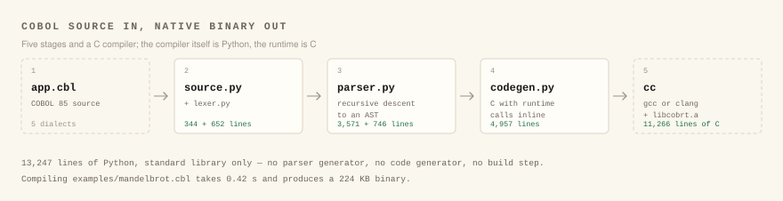
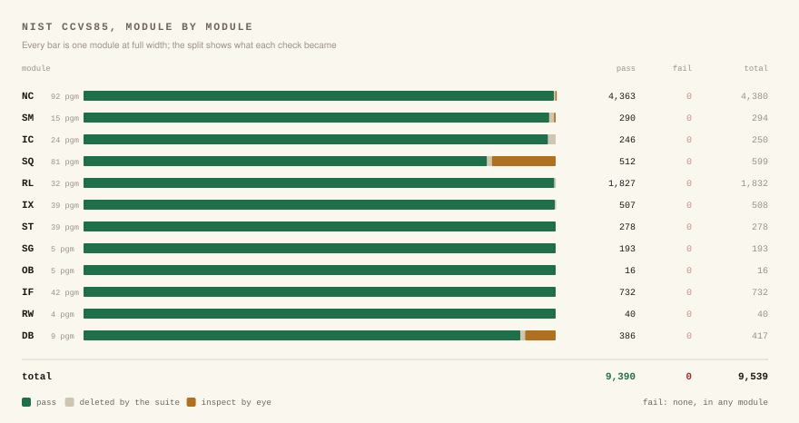

<h1 align="center">YACCC</h1>

<p align="center"><b>Yet Another COBOL C compiler</b><br>
COBOL 85 in, C out, a native executable at the end — written in standard-library Python.</p>

<p align="center">
  <a href="https://github.com/luckyseoul/yaccc/actions/workflows/ci.yml"></a>
  <a href="https://github.com/luckyseoul/yaccc/releases/latest"></a>
  <a href="LICENSE"></a>
  
  
  
</p>

YACCC compiles COBOL. It reads COBOL 85 source — with the extensions from the
1989 intrinsic-function amendment and later standards that real programs
depend on — translates it to C, and hands that to gcc or clang along with a
small runtime library. What comes out is an ordinary native executable, with
no interpreter or VM behind it.

The name is the joke; the conformance results are not. It passes the NIST
CCVS85 conformance suite with no failures: 387 programs, 9,390 checks, every
module matching the suite's reference summary line for line, Report Writer and
Debug included.

The front end and code generator are 18,378 lines of Python that use nothing
outside the standard library — no parser generator, no code generator, no
build step. Compiling the Mandelbrot example takes 0.46 seconds and produces a
443 KB executable that runs at about three times the speed of the same program
built by GnuCOBOL.

```
$ ./yaccc examples/mandelbrot.cbl --run           # compile and run
$ ./yaccc -std=ibm examples/payroll.cbl -o payroll # build an executable, IBM dialect
$ ./yaccc -t payroll.lst -Xref examples/payroll.cbl # with a listing and cross-reference
```



| Start here | Using it | Inside |
|---|---|---|
| [By the numbers](#by-the-numbers) | [Dialects](#dialects) | [Language coverage](#language-coverage) |
| [Results](#results) | [Running programs](#running-programs) | [Compatibility](#compatibility) |
| [Requirements](#requirements) | [Diagnostics and debugging](#diagnostics-and-debugging) | [How it works](#how-it-works) |
| [Usage](#usage) | [Editor support](#editor-support) | [Repository layout](#repository-layout) |
| [Calling C, and C calling COBOL](#calling-c-and-c-calling-cobol) | [Screen I/O](#screen-io) | [Credits](#credits) |
| [Files shared between programs](#files-shared-between-programs) | [Embedded SQL](#embedded-sql) | [License](#license) |

## By the numbers

- **0** failures across the NIST CCVS85 conformance suite: 387 programs,
  9,390 checks, twelve modules.
- **0.46 s** to compile `examples/mandelbrot.cbl` into a 443 KB executable,
  which then runs in 40 ms.
- **18,378** lines of Python in the compiler, standard library only.
- **576** of GnuCOBOL 3.1.2's own runtime tests pass, and none fail — a
  compatibility check, not a conformance one. The 117 that are skipped need a
  terminal, GnuCOBOL's C API, shell scripting, or a `cobc` option YACCC does
  not imitate.
- **85** differential programs of its own, comparing output and files byte for
  byte against recorded GnuCOBOL 3.1.2 results; 77 also run live against `cobc`.
- **1** NIST test that cannot pass unattended: OBNC1M prints
  `STOP "OPERATOR KILL OBNC1"` and waits for a human to kill the job.

COBOL's standards, for orientation: CODASYL began the work in 1959, COBOL-60
was published within the year, the first ANSI standard arrived in 1968, and
COBOL 85 — the dialect this compiler targets — in 1985. ISO revised it in
2002, 2014 and 2023; the pieces from those revisions are labelled
"COBOL 2014" and "COBOL 2023" throughout.

## Results

### NIST CCVS85 conformance suite

Run with `make nist`. The first ten modules use the same program set as the
suite's reference `summary.txt`:

```
Module Programs Executed Error Crash   Pass Fail Deleted Inspect Total
------ -------- -------- ----- -----  ----- ---- ------- ------- -----
NC           92       92     0     0   4363    0       6      11  4380
SM           15       15     0     0    290    0       3       1   294
IC           24       24     0     0    246    0       4       0   250
SQ           81       81     0     0    512    0       6      81   599
RL           32       32     0     0   1827    0       5       0  1832
IX           39       39     0     0    507    0       1       0   508
ST           39       39     0     0    278    0       0       0   278
SG            5        5     0     0    193    0       0       0   193
OB            5        5     0     0     16    0       0       0    16
IF           42       42     0     0    732    0       0       0   732
RW            4        4     0     0     40    0       0       0    40
DB            9        9     0     0    386    0       4      27   417
Total       387      387     0     0   9390    0      29     120  9539
```

NC through IF match the reference summary line for line. "Deleted" tests are
removed by the suite itself. "Inspect" tests have no automatic pass/fail check:
their printed output has to be reviewed by eye, as for any compiler.



RW (Report Writer) and DB (Debug module) are not in the suite's reference
summary, so there is no published line to match; both are run and reported
here. The DB programs run with the object-time debugging switch on
(`COB_SET_DEBUG=Y`), except DB102A, which checks that debugging procedures stay
inactive when it is off. DB205A needs the Communication module and is not run.

The reference run skips eight programs: SQ207M, SG102A, SG103A, SG201A–SG203A,
OBNC1M and OBNC2M. `make nist-all` includes them, and YACCC compiles and runs all
eight:

- **SG102A–SG203A** (ALTER and segmentation): 117 more tests pass.
- **OBNC2M**: 16 more tests pass.
- **OBNC1M**: 6 tests pass. Its 7th test executes `STOP "OPERATOR KILL OBNC1"`
  and passes only if an operator kills the job at that prompt, so it can't pass
  unattended.
- **SQ207M**: 8 tests that need visual inspection.

| | Programs | Pass | Fail | Deleted | Inspect | Total |
|---|---|---|---|---|---|---|
| `make nist-all` | 395 | 9529 | 1 | 29 | 128 | 9687 |

The NIST programs are module-split by opensource COBOL's `expand.pl`. They're
tracked in the opensourcecobol4j repository under `tests/cobol85`. `make nist`
fetches them into `third_party/` with a sparse clone (about 65 MB).

### Differential tests against GnuCOBOL

`tests/cases/` holds 85 programs covering moves, editing, arithmetic and
rounding modes (including division by full-precision intrinsic results), PERFORM, EVALUATE, STRING/UNSTRING/INSPECT, tables and SEARCH,
intrinsic functions (including the COBOL 2014 date functions and the
high-precision math), OCCURS DEPENDING ON layouts (with and without
`-fodoslide`), OS/VS PERFORM and arithmetic, ASSIGN names (IBM DD names
under `-std=ibm`), COPY and REPLACING, free format, DECIMAL-POINT IS COMMA,
ACCEPT, CALL and CANCEL, library routines and exception functions, ALTER,
declaratives, sequential, relative and indexed files (including READ PREVIOUS,
START FIRST/LAST and DELETE FILE), SORT, Report Writer and the Debug module,
conditional compilation inside a copybook, and report items placed without a
COLUMN clause, and JSON and XML GENERATE and PARSE.

- `make test` compares each program's output and every file it writes against
  recorded GnuCOBOL 3.1.2 baselines. The exceptions are `advmix`, `rw1`, `dbg2`,
  `dbg5` and `lstrunc`, cases where YACCC deliberately differs from GnuCOBOL, and
  `jsonparse1`, `xmlparse1`, `genocc1`, `fnutf8`, `lssplit` and `sysrtn2`,
  which use what GnuCOBOL 3.1.2 doesn't have; their baselines were verified
  by hand.
- Four tests added with the fixes below (`dirord`, `occurs01`, `rwsrc`, `rwlimit`)
  had no live `cobc` to record from, so their baselines were checked by hand
  against the standard. `rwlimit` is marked `.noref` because `cobc` rejects
  the program (it names a report group `PH`, which `cobc` reserves).
- Each case may add sidecars: `.in` (stdin), `.args` (the program's own
  arguments), `.flags` (compile flags), `.env` (environment), `.nocmp` (files
  not compared) and `.outfiles/` (files the program writes).
- `make test-ref` compiles the reference live and compares against what
  `cobc` actually prints and writes, ignoring the recorded baselines
  altogether (`cobc` must be on `PATH`); see `docs/gnucobol-oracle.md` for
  building one without root. CI builds GnuCOBOL 3.1.2 and runs this on every
  push, so the comparison is enforced rather than optional. Against GnuCOBOL
  3.1.2, 77 of the 85 run and pass. Fourteen of those are `.noref` cases,
  where YACCC deliberately differs — mostly things 3.1.2 does not implement —
  and which are compared with their baselines rather than with `cobc`. Five
  are skipped because `cobc` rejects the test program itself, and three
  because the reference build has no ISAM handler: a `--without-db` cobc
  compiles an indexed-file program happily and then fails every I/O call with
  status 48, so it has nothing to say about them.

All 85 pass, built with gcc.

Because GnuCOBOL is both the reference and the thing YACCC aims to match,
agreeing with it cannot by itself show that the *standard* was implemented
rather than a GnuCOBOL quirk reproduced. `make three-way` compiles the same
programs with a second independent implementation, GCC's COBOL front end, and
reports where the three disagree; no case yet has YACCC differing from both.
See [docs/three-way.md](docs/three-way.md).

### GnuCOBOL 3.1.2 testsuite

`make gctest` runs the runtime tests of GnuCOBOL's own testsuite (the
`run_*.at` and `data_*.at` autotest files) with YACCC. It fetches them into
`third_party/` with a sparse clone of the 3.1.2 release tag.
`tests/gnucobol/run_gc.py` reads the autotest files directly and runs every
test that is built from COBOL sources with plain compile steps, comparing exit
status, standard output and the files the test checks. Programs the tests
compile as modules (`$COMPILE_MODULE`) are built as real loadable modules with
`yaccc -m` and found by CALL at run time, and C files are compiled with them.

```
Tests  Pass  Fail  Compile error  Skipped
  693   576     0              0      117
```

The same harness can run `cobc` instead (`run_gc.py --cobc`), which is the
quickest way to tell a YACCC defect from a test that depends on how the
compiler was built or on the environment. Run that way against GnuCOBOL
3.1.2, **no test passes under `cobc` and fails under YACCC**. The comparison is
not symmetric: 62 tests are recorded as passing here that this `cobc` does not
pass, mostly indexed-file tests it cannot run at all because it was built
without an ISAM handler, and a few where its own behaviour differs.

The run fails if a test recorded as passing in `tests/gnucobol/results.txt` no
longer passes. `make gctest-update` records a new baseline.

- **Skipped** tests need things the harness can't provide: a terminal and
  someone to look at it (the 48 manual SCREEN SECTION tests, checked by hand
  instead; see *Screen I/O*), GnuCOBOL's own C
  API (`cob_get_field_str`, `cob_global` and the like, 6 tests), shell
  scripting, or a cobc option YACCC has no equivalent for (`-fcallfh` and
  a few more). One is a deliberate difference: a COBOL program called from a C
  `main` starts the runtime itself instead of failing with *cob_init() has not
  been called*.
- **Compile errors**: none. Every program the harness can build, YACCC builds.
- **Failures**: none. The last two, *Sample Payroll Report* and *Sample
  Inventory Report*, were Report Writer page placement and PRESENT WHEN; see item 1
  of the [conformance history](docs/conformance-history.md).

### Performance

`examples/mandelbrot.cbl` (COMP-5 and fixed-point arithmetic in tight loops) runs
in about 40 ms with YACCC, against about 130 ms for a GnuCOBOL 3.1.2 build at
`-O2` on the same machine.

A loop of 100,000 iterations of `Y ** 12.5`, `FUNCTION SQRT` and `FUNCTION SIN`
takes 4.2 seconds with YACCC and 136 seconds with GnuCOBOL, with identical
results.

## Requirements

- Python 3.11 or newer (tested with 3.11, 3.12 and 3.13). The compiler uses only
  the standard library.
- A C compiler with GNU extensions: gcc (tested with 13.3) or clang. The
  generated code uses computed `goto`, `__int128` and statement expressions.
- GnuCOBOL is **not** needed. It is used only as a reference by `make test-ref`.
- For embedded SQL, at run time: libsqlite3 for SQLite, libpq for PostgreSQL
  (loaded when a program connects; nothing is needed to compile).

## Install

```
pip install https://github.com/luckyseoul/yaccc/releases/download/v1.0/yaccc-1.0-py3-none-any.whl
# or, from a checkout:
pip install .
```

That gives you a `yaccc` command, and `python -m yaccc` works too. The wheel is
pure Python but carries the C runtime as data, so a C compiler is still needed
at run time — it is compiled on first use, not at install time.

The package is not on PyPI yet, so install it from the release wheel or a
checkout as above rather than by bare name.

The runtime library is built automatically the first time you compile a
program: into `runtime/libcobrt.a` in a source checkout, or into
`$XDG_CACHE_HOME/yaccc` (default `~/.cache/yaccc`) when installed, so that
site-packages is never written to. Set `YACCC_RUNTIME` to point at a runtime
source tree of your own if you keep one elsewhere. `make` builds it ahead of
time in a checkout.

From a source checkout, `make install` puts the compiler and its runtime under
`$(PREFIX)/lib/yaccc` and links `$(PREFIX)/bin/yaccc` to it (`PREFIX` is
`/usr/local` unless you set it; `make install PREFIX=$HOME/.local` installs for
one user, and `make uninstall` with the same `PREFIX` removes it).

## Usage

```
./yaccc examples/payroll.cbl                 # builds ./payroll
./yaccc examples/payroll.cbl -o payroll      # explicit output name
./yaccc examples/mandelbrot.cbl --run        # build and run
./yaccc -C examples/bank.cbl                 # translate only: writes bank.c
./yaccc tests/cases/copy1.cbl -I tests/cases # copybook directory
```

To make an executable from several programs, pass all the sources on one
command line. The first source is the main program, and CALL / CANCEL resolve
the others by PROGRAM-ID, whether the name is a literal or held in a data item:

```
./yaccc examples/dayname.cbl examples/datefmt.cbl --run
```

Programs can also be compiled separately, into object files or into modules
that CALL loads when it first needs them, and C files, object files and
libraries can go on the same command line (see *Calling C, and C calling
COBOL* below):

```
./yaccc -c -x main.cbl                  # main.o, holding main()
./yaccc -c sub.cbl                      # sub.o
./yaccc main.o sub.o -o app             # link them
./yaccc -m plugin.cbl                   # plugin.so, loaded by CALL "plugin"
./yaccc main.cbl helpers.c -lm          # COBOL and C in one executable
```

| Option | Meaning |
|---|---|
| `-o FILE` | output file |
| `-C` | write the generated C and stop |
| `-c` | compile each source to an object file (`.o`) and don't link; with `-x` the object holds `main()` |
| `-m` | build each source as a loadable module (`.so`) that CALL finds through `COB_LIBRARY_PATH` |
| `-x` | build an executable (the default) |
| `-E` | write the source as the parser sees it — copybooks expanded, REPLACE applied, directives evaluated — as free-format COBOL that compiles to the same program |
| `-fsyntax-only` | check the program and report every error; write nothing |
| `-l LIB`, `-L DIR` | link with a library, and where to find it |
| `-free` / `-fixed` | source format; otherwise detected per file, and `>>SOURCE FORMAT` / `$SET SOURCEFORMAT` switch it |
| `-I DIR` | copybook directory (also `$COBCPY`) |
| `-D NAME[=VALUE]` | define a compilation variable for `>>IF` / `>>DEFINE ... AS PARAMETER` / `CONSTANT FROM` |
| `-O N` | C optimisation level (default 2) |
| `-g` | C debug information, with `#line` mapping so a debugger shows COBOL source |
| `--no-check` | drop subscript and reference-modification range checks |
| `-std DIALECT` | the choices the standards leave open (see below; default `default`) |
| `--binary-size 2-4-8 \| 1-2-4-8` | storage sizes for BINARY/COMP items (default: from the dialect) |
| `-fbinary-truncate` / `-fno-binary-truncate` | whether a BINARY item is limited to its PICTURE's digits |
| `-fmissing-period` / `-fno-missing-period` | whether a statement may stand where a `.` is required |
| `--debugging-mode` | compile as if `WITH DEBUGGING MODE` were specified: debugging lines and USE FOR DEBUGGING |
| `--keep-c` | keep the generated C file next to the executable |
| `-ftrace` / `-ftraceall` | trace program entry and exit, sections and paragraphs (`-ftraceall`: every statement too) while `READY TRACE` or `COB_SET_TRACE=Y` has tracing on |
| `-fintrinsics=all` or `=NAME,...` | intrinsic functions that need no `FUNCTION` keyword, as `REPOSITORY. FUNCTION ALL INTRINSIC` allows |
| `-fnot-reserved=WORD,...` / `-freserved=WORD,...` | reserved words the program may use as its own names (a word that begins a statement stays reserved), and words to reserve besides the standard ones |
| `-fsign=ascii\|ebcdic` | how a signed DISPLAY item stores an embedded sign: `ascii` (negative digits are 0x70–0x79, the default) or the EBCDIC overpunch letters `{A`–`I` and `}J`–`R` |
| `-fdefaultbyte=init\|C\|N` | what WORKING-STORAGE without a VALUE clause starts as: spaces and zeros by type (`init`, the default), a character, or a byte value |
| `-fsticky-linkage` | a LINKAGE item keeps its address from one call to the next when the caller passes nothing for it |
| `-fno-recursive-check` | allow a CALL of an active program that isn't RECURSIVE |
| `-fno-stack-trace` | leave out the bookkeeping that lets a runtime error list the PERFORMs that led to it (a PERFORM a little faster; the CALLs are still listed) |
| `-fdump[=ALL\|WS,LO,LS,FD]` | after a runtime error, a crash or SIGQUIT, write out the program's data: WORKING-STORAGE (`WS`), LOCAL-STORAGE (`LO`), LINKAGE (`LS`), the files and their records (`FD`), or all of them (`ALL`, also `-fdump` alone) |
| `-ffilename-mapping` / `-fno-filename-mapping` | map ASSIGN names at OPEN through the environment and `COB_FILE_PATH` (the default), or use them as they stand |
| `-fimplicit-init`, `-fentry-statement=ok` | accepted for cobc command lines: a COBOL program called from C always starts the runtime itself, and ENTRY is always accepted |
| `--cc CC` | C compiler (default `$CC`, then gcc, then cc) |
| `--run` | run the program after building; its arguments follow, and ones that begin with `-` go after `--` |

<details>
<summary><b>cobc options that build scripts carry over</b> — accepted and working the same way (click to expand)</summary>

| Option | Effect |
|---|---|
| `-j`, `-job[=ARGS]` | build and run the program, ARGS (one string, split as a shell would) its arguments |
| `-i`, `-info` | show how YACCC is set up: version, C compiler, runtime, and the environment variables it reads |
| `-q`, `-brief` | no display of the commands run (the default; `-v` shows them) |
| `-F` | free-format source (`-free`) |
| `-ftext-column=N` | the right margin of fixed-format source: program text is columns 8 to N (72 to 255; 72 by default) |
| `-fmax-errors=N` | the errors a compile reports before it stops (20 by default) |
| `-t FILE`, `-T FILE` | write a listing of the compile to FILE (below); `-T` is the same, as the listing is never cut to a page width |
| `-P[=DIR\|FILE]`, `-ftsymbols` | the listing in FILE, or as SOURCE.lst in DIR or here; it always has the data map `-ftsymbols` asks for |
| `-Xref` | add a cross-reference to the listing (with no `-t`, the listing is `SOURCE.lst`) |
| `-A OPTIONS`, `-Q OPTIONS` | options for the C compiler and for the link, split as a shell would; each may be repeated |
| `-save-temps[=DIR]` | keep the generated C, in DIR or the current directory |
| `-w` | no warnings |
| `-Wall`, `-W`, `-Wextra` | every warning (the default) |
| `-Wno-NAME` | not that warning; each warning ends with its name, as in `[-Wcolumn-overflow]`, and the names are cobc's |
| `-Werror` | a warning fails the compile |
| `-d`, `-debug` | every run-time check (subscripts, reference modification, OCCURS DEPENDING ON, numeric data) and the stack trace, whatever `--no-check` says |
| `-fec=NAME`, `-fno-ec=NAME` | those checks on or off: the range checks `EC-ALL`, `EC-BOUND`, `EC-BOUND-SUBSCRIPT`, `EC-BOUND-REF-MOD`, `EC-BOUND-ODO` (on by default), and the data check `EC-DATA-INCOMPATIBLE` (or `EC-DATA`; off by default, below). The other checks are always made |
| `-fbinary-size=2-4-8\|1-2-4-8\|1--8`, `-fbinary-byteorder=big-endian\|native` | the storage of BINARY items (see *Dialects*; `--binary-size` is the same option) |
| `-fbinary-comp-1` | COMP-1 is a signed binary integer of two bytes, as `$SET COMP-1(BINARY)` makes it |
| `-fassign-clause=dynamic\|mf\|external\|ibm` | what `ASSIGN word` names (see *Dialects*) |
| `-fnot-register=NAME` | NAME (`TALLY`, `RETURN-CODE`, ...) is an ordinary word rather than a special register |
| `-facu-literals=ok` | ACUCOBOL's `B#`, `O#`, `X#` and `H#` numeric literals |
| `--lsp` | run as a Language Server Protocol server for an editor (see *Editor support*) |
| `-fprof` | profile the run: each section's and paragraph's calls and own time, written as CSV when it ends (see below) |
| `-fodoslide`, `-fno-odoslide` | every table with OCCURS DEPENDING ON takes its current size and what follows it in the record moves up (IBM's layout; Micro Focus's `$SET ODOSLIDE` does the same), or not (the default; see *OCCURS DEPENDING ON*) |
| `-fcomplex-odo` | accepted: a table with OCCURS DEPENDING ON may be followed by other items, or nested, without it |
| `-fperform-osvs`, `-farithmetic-osvs`, `-fmove-ibm` | OS/VS PERFORM returns, intermediate precision, and IBM's overlapping MOVE (see *Dialects*; `-std=ibm` sets all three) |
| `-fref-mod-zero-length`, `-fno-ref-mod-zero-length` | a zero-length reference modification allowed, or an error (see *Dialects*) |
| `-frelax-syntax-checks` | an inline PERFORM may end at a period instead of END-PERFORM (with a warning); the other things this cobc option relaxes, YACCC allows anyway |
| `-fmissing-statement=ok`, `-flarger-redefines-ok`, `-ftop-level-occurs-clause=ok`, `-fno-constant-folding`, `-fassign-ext-dyn=ok`, `-fno-program-name-redefinition`, `-fsystem-name=NAMES` | accepted, as what they allow is always allowed: an empty inline PERFORM or IF branch, a REDEFINES larger than what it redefines, OCCURS at level 01, ASSIGN EXTERNAL and DYNAMIC, `CALL name` / `CANCEL name` of a program (or REPOSITORY prototype) that no data item is named after, and the switch names `SWn`, `SWITCH n`, `SWITCH A` to `SWITCH Z` (1 to 26) and `USW-n` |
| `-fno-implicit-assign-dynamic-var` | `ASSIGN word`, a word no data item has, is the file's external name (IBM label parts dropped) rather than a PIC X item holding the word |
| `-fno-dump[=WS,LO,LS,FD]` | leave these sections, or the whole dump, out of what `-fdump` asks for |
| `-fstatic-call` | a CALL literal names a program or C function that is linked in (an object file, a library): the link fails without it, rather than the CALL when it runs. `-fno-static-call` (the default) looks for it then, in the run unit, then C, then a loadable module |
| `-fsingle-quote` | the figurative constant QUOTE is an apostrophe |
| `-fdefault-colseq=EBCDIC\|ASCII\|NATIVE` | the collating sequence of a program that names none |
| `-fmfcomment` | `*` or `/` in column 1 makes a fixed-format line a comment, as Micro Focus allows |
| `-ffold-copy=UPPER\|LOWER`, `-fstack-check`, `-fsource-location` | accepted, as what they ask for is always so: a copybook's name is looked for as written and in both cases, the PERFORM stack is always checked, and run-time errors always give their source line |

</details>

The data check (`-fec=EC-DATA-INCOMPATIBLE`, or `-debug`) is the one for
the mainframe's S0C7: a numeric DISPLAY or packed-decimal item that a MOVE,
an arithmetic statement, COMPUTE or SET reads must hold a number, or the run
ends there, with the item, its usage and its bytes, as cobc words it:

```
cobrt: runtime error: pay.cbl:15: 'HOURS' (Type: NUMERIC DISPLAY) not numeric: '   '
cobrt: runtime error: pay.cbl:17: 'RATE' (Type: PACKED-DECIMAL) not numeric: '0x414243'
```

Without it, such an item is read as the digits its bytes come to, as cobc
reads it, and the arithmetic goes on. As with cobc, a comparison, DISPLAY,
a class test, or an argument of an intrinsic function is not checked.

Without the range checks (`--no-check`, `-fno-ec`) a subscript past the end
of a table reaches the storage after it, as with cobc: the generated C is
compiled without the C library's `_FORTIFY_SOURCE`, which some distributions
turn on by default and which would end such a program with "buffer overflow
detected".

An option this compiler does not implement is an error, never a silent no-op,
and neither is an unknown dialect name. A `-f` option overrides the same
setting from `-std`.

Arguments for the program being run follow `--run`; those that begin with `-`
follow `--`:

```
./yaccc prog.cbl --run 2026-10-28      # one argument to the program
./yaccc prog.cbl --run -- --verbose    # an option-like argument to the program
```

### Dialects

`-std` selects the choices a compiler has to make where the standards leave one
open, or where implementations have long differed. A dialect is not a claim of
conformance to a vendor's implementation: it sets the settings below, and
`-f` overrides the first three individually.

| Dialect | `binary-size` | `binary-truncate` | `missing-period` | `host-sign` | `non-numeric-zero` | `space-raw` | `pretty-display` | `arithmetic-osvs` | `perform-osvs` | `move-ibm` | `ref-mod-zero-length` | `assign-clause` | `acu-literals` |
|---|---|---|---|---|---|---|---|---|---|---|---|---|---|
| `default` | 2-4-8 | on | no | no | no | no | on | no | no | no | yes | dynamic | no |
| `cobol85`, `cobol2002`, `cobol2014` | 2-4-8 | on | no | no | no | no | on | no | no | no | no | dynamic | no |
| `gnu` (GnuCOBOL) | 2-4-8 | on | yes | no | no | no | on | no | no | no | yes | dynamic | no |
| `ibm` (also `mvs`) | 2-4-8 | off | yes | yes | no | no | off | yes | yes | yes | no | ibm | no |
| `mf` (Micro Focus) | 1-2-4-8 | off | yes | no | yes | no | on | no | no | no | no | dynamic | no |
| `acu` (ACUCOBOL) | 1-2-4-8 | on | yes | no | no | yes | on | no | no | no | no | dynamic | yes |

cobc's `-strict` names (`ibm-strict`, `mvs-strict`, `mf-strict`,
`acu-strict`) select the same settings, with a note that YACCC does not
implement every restriction a strict dialect would impose.

The named ISO standards also *reject* what the standard rejects, rather than
only choosing settings. Measured against `cobc` 3.1.2, and applied here:

| Rule | Enforced by |
|---|---|
| a level-01 item cannot have `OCCURS` | `cobol85`, `cobol2002`, `cobol2014` |
| `PERFORM VARYING` requires a `BY` phrase | `cobol85` (optional from 2002) |
| `TERMINAL`, `SEND`, `DEBUGGING`, `SEGMENT`, `SUB-QUEUE-1..3` are reserved | `cobol85`, `cobol2002` (unreserved in 2014) |
| `ENTRY FOR GO TO` / `GO TO ENTRY` are not available | every ISO dialect, `gnu`, and every `-strict` dialect |
| a data item cannot take a special register's name | `ibm`, `mvs`, `ibm-strict`, `mvs-strict` (ACUCOBOL allows `tally` to be redefined, and GnuCOBOL's `cobol85` and `acu-strict` follow suit) |

- **`binary-size`** — the byte widths `PIC 9(n) COMP` uses. Under `2-4-8`
  (IBM and the default here) a 2-digit COMP item occupies 2 bytes; under
  `1-2-4-8` (Micro Focus) it occupies 1; under `1--8` (`-fbinary-size=1--8`)
  the fewest bytes that hold the digits, signed or not (`PIC 9(7)` in 3,
  `PIC S9(7)` in 4). `-fbinary-byteorder=native` stores BINARY items in the
  machine's byte order instead of big-endian, still cut to their PICTURE as
  `binary-truncate` says.
- **`binary-truncate`** — whether a COMP item holds only the digits of its
  PICTURE. With truncation on, `PIC 9(2) COMP` given 12345 holds 45. With it
  off, the item holds what its bytes can represent (12345 in two bytes is
  0x3039, which reads back as 57) — the Micro Focus behaviour.
- **`missing-period`** — whether a statement may stand at a point where a `.`
  is required. The standards require the period; several implementations accept
  its absence, and so does YACCC under these dialects.
- **`host-sign`** — whether a signed PACKED-DECIMAL item whose sign nibble is
  `F` passes the NUMERIC class test, as on IBM mainframes.
- **`non-numeric-zero`** — whether MOVE of SPACE, QUOTE, LOW-VALUE, HIGH-VALUE
  or an alphanumeric literal that isn't all digits to a numeric item moves zero
  (with a warning), as Micro Focus does.
- **`space-raw`** — whether MOVE SPACE to a numeric DISPLAY item stores spaces,
  the way MOVE LOW-VALUE and HIGH-VALUE store their bytes.
- **`pretty-display`** — whether `DISPLAY` of a numeric item writes its decimal
  point and a leading sign. With it off the stored digits are written as they
  stand, a `SIGN LEADING` item puts its sign first and any other signed DISPLAY
  item puts it last, and a BINARY item is printed at the width of its storage
  rather than of its PICTURE. `-fnotrunc` turns this off too, as `cobc` does.
- **`arithmetic-osvs`** — whether a `COMPUTE` of more than one operation cuts
  each intermediate result back to a scale OS/VS COBOL derives from the
  operands: the larger operand scale for `+` and `-`, their sum for `*`, and
  for `/` the larger of the operand difference and the largest scale in the
  statement (a numeric-edited receiver's decimal places included), in a
  COMPUTE and in a condition alike. `20500 / 0.9 / 33.45` into `PIC S9(7)V99`
  is 680.94 with it on and 680.95 with it off, and `cobc` warns about every
  statement it changes. `-farithmetic-osvs` / `-fno-arithmetic-osvs` set it.
- **`perform-osvs`** — whether a PERFORM returns when control reaches the end
  of its range while a PERFORM begun after it is still active (a `GO TO` out of
  the inner one's paragraph, say), the PERFORMs begun since abandoned, as OS/VS
  and IBM's compilers do. Without it only the most recent PERFORM returns, and
  control goes on past the end of the outer range. `-fperform-osvs` /
  `-fno-perform-osvs` set it.
- **`assign-clause`** — what `ASSIGN word` means when a data item has that
  name: the file the item names (`dynamic`, also `mf`), or the word itself
  (`external`, also `ibm`). A word that names no item is the file's name in
  both, kept as written (`ASSIGN payroll` opens `payroll`, as cobc does), and
  `ASSIGN EXTERNAL` / `ASSIGN DYNAMIC` say which explicitly. An external name
  is an IBM assignment-name, `[comments-][S-|AS-]ddname`: `UT-S-PAYOUT` opens
  `PAYOUT`, with a warning, and `DD_PAYOUT` in the environment can map it to
  any file, as a JCL DD statement would.
- **`acu-literals`** — whether `B#101`, `O#777`, `X#FF` and `H#FF` are numeric
  literals in base 2, 8 and 16, as in ACUCOBOL (`-facu-literals=ok`).
- **`move-ibm`** — whether an alphanumeric MOVE whose receiving bytes begin
  inside the sending ones copies left to right a byte at a time, as IBM's MVC
  instruction does, so that a byte propagates: `MOVE SPACE TO REC (1:1)`
  then `MOVE REC (1:79) TO REC (2:79)` clears REC, the old mainframe idiom.
  Without it the bytes move as they were. `-fmove-ibm` / `-fno-move-ibm`
  set it.
- **`ref-mod-zero-length`** — whether a reference modification of length zero
  is allowed (it names no bytes) or, with the range checks on, a run-time
  error, as in every named dialect of cobc. `-fref-mod-zero-length` /
  `-fno-ref-mod-zero-length` set it.

`yaccc -std=ibm prog.cbl` and `yaccc -std=mf prog.cbl` therefore produce
different binaries for the same source. Anything not listed above is the same
in every dialect.

## Running programs

The runtime reads these environment variables:

| Variable | Meaning |
|---|---|
| `DD_name`, `dd_name`, `name` | the file an `ASSIGN` name without a directory or extension opens; a leading `$VAR/` takes the directory from `VAR` |
| `COB_FILE_PATH` | directory for a file whose (mapped) name has none |
| `COB_SWITCH_n=ON\|OFF` | external switches (SPECIAL-NAMES `SWITCH-n`/`UPSI-n`) |
| `COB_SET_DEBUG=Y` | object-time debugging switch: USE FOR DEBUGGING procedures run only when it's set (`Y`, `YES`, `ON`, `TRUE` or `1`), as in GnuCOBOL |
| `COB_CURRENT_DATE` | fixed date and time for ACCEPT FROM DATE/DAY/TIME and the date functions, for reproducible test runs: `YYYY/MM/DD hh:mm:ss`, optionally followed by `+hhmm` (the time part is optional) |
| `COB_SET_TRACE` | `Y`: start with tracing on in programs compiled with `-ftrace` or `-ftraceall` |
| `COB_TRACE_FILE` | write the trace to this file instead of standard error (`+file` appends) |
| `COB_TRACE_FORMAT` | the layout of a trace line: `%P` program, `%S` what is traced (`Paragraph: NAME`), `%L` line, `%F` source file; default `Program-Id:  %P%S Line: %L` |
| `COB_LIBRARY_PATH` | directories, `:`-separated, where CALL looks for a module `NAME.so` before the current directory |
| `COB_TIMEOUT_SCALE=0\|1\|2\|3` | the unit of ACCEPT ... TIMEOUT: a second (0, the default), a tenth (1), a hundredth (2), a thousandth (3), as in GnuCOBOL |
| `COB_RUNTIME_CONFIG` | a file of these settings, read when the program starts, in GnuCOBOL's `runtime.cfg` format (below); without it, `COB_CONFIG_DIR/runtime.cfg` when `COB_CONFIG_DIR` is set |
| `COB_PRE_LOAD` | modules to load at start-up, `:`-separated, so CALL finds the programs and ENTRY points they hold |
| `COB_LS_SPLIT=Y` | a LINE SEQUENTIAL line longer than the record is read as several records (status 06), not cut short (status 04) |
| `COB_LS_FIXED=Y` | a LINE SEQUENTIAL record is written at its full length, trailing spaces kept |
| `COB_LS_NULLS=Y` | in a LINE SEQUENTIAL record, a character below space is written after a NUL and read back from the two, so a record can hold any byte, a newline too |
| `COB_VARSEQ_FORMAT=0\|1\|2\|3` | the header before each record of a variable-length SEQUENTIAL file, as GnuCOBOL has it: two bytes big-endian then two zero bytes (0, the default), four bytes big-endian (1), four bytes in the machine's order (2), two bytes big-endian (3) |
| `COB_SYNC=Y` | each change to a relative or indexed file waits until it is on the disk |
| `COB_STACKTRACE=N` | a runtime error or a signal prints no stack trace, only its message |
| `COB_PROF_FILE` | the file a `-fprof` profile is written to (`$$` the process id) instead of `prof-PROGRAM.csv` |
| `COB_DUMP_FILE` | the file a `-fdump` dump is appended to, instead of standard error; `NONE`: no dump |
| `COB_SQL_DATABASE`, `COB_SQL_USER`, `COB_SQL_PASSWORD` | the database of a program that runs SQL without CONNECT |
| `COB_SQL_TRACE=Y` | write each SQL statement and its SQLCODE to standard error |
| `COB_SQL_SAVEPOINT=N` | PostgreSQL: no savepoint around each statement (faster; an error then spoils the unit of work) |
| `COB_SQLITE_LIBRARY`, `COB_PQ_LIBRARY` | the path of libsqlite3 or libpq when it isn't found by its usual name |

A runtime configuration file, as GnuCOBOL's `runtime.cfg`, holds the same
settings as lines of `TAG VALUE`, the tag being the variable's name with or
without `COB_` in either case (`ls_fixed true`, `file_path /data/in`). `#`
starts a comment, a value may be quoted, and `${NAME}`, `${NAME:-default}` and
`${NAME:default}` in a value are another variable's value. `setenv NAME VALUE`,
`unsetenv NAME`, `reset TAG`, `include "FILE"` and `includeif "FILE"` work as
in GnuCOBOL, and a variable already in the environment wins over the file. An
unknown tag, a recursive include or a file that isn't there is a
configuration error reported before the program starts, in cobc's words; a
file shared with GnuCOBOL works, its tags YACCC has no use for accepted.

## Diagnostics and debugging

Compile errors name the file and line and print the offending source line.
One run reports every error it can: the parser goes on at the next sentence
or data entry, and code generation at the next statement, up to 20 errors. A
misspelt verb, clause, function, data name or paragraph gets the nearest
spelling that exists:

```
errs.cbl:7: error: unexpected word in data description, found 'VALU'; did you mean 'VALUE'?
  7 |        01 WS-BAD       PIC 9(3) VALU 0.
errs.cbl:11: error: statement expected, found 'DISPLY'; did you mean 'DISPLAY'?
  11 |            DISPLY "HELLO".
errs.cbl:15: error: unknown intrinsic function 'SQRTT'; did you mean 'SQRT'?
  15 |            COMPUTE WS-TOTAL = FUNCTION SQRTT(4).
3 errors
```

Two classic COBOL mistakes get named outright, because the error they cause
says nothing about them:

- **Code past column 72.** In fixed-format source everything after column 72
  is ignored, so a statement that runs past the margin loses its end. An error
  on such a line, or the line after it, says what was cut off, and a line that
  runs past column 80 gets a warning even when it happens to compile.
- **A missing period before a paragraph.** Without it the paragraph header
  becomes an operand of the statement before it; the error says *it looks
  like a paragraph header: is the period missing at the end of the statement
  before it?*

A bug in the compiler itself is reported as an internal error with the
statement it was compiling, not as a Python traceback
(`YACCC_TRACEBACK=1` shows the traceback).

`-t FILE` writes a listing of the compile: the source as written, every line
numbered, each copybook's lines after the COPY that brought them in (numbered
in the copybook and marked `C`), each error and warning under its line, and
a data map of every program — each item's offset, size, PICTURE and USAGE.
`-Xref` adds where each data item, index and procedure is used: `*` marks a
reference that changes the item, and `P`, `G`, `A` and `S` a procedure's
PERFORM, GO TO, ALTER and SORT or MERGE procedure. Items no statement uses
are named as such:

```
     5         COPY CUSTREC.
       --- COPY CUSTREC.cpy
     1C        01 CUST-REC.
     2C           05 CUST-ID      PIC 9(5).
     3C           05 CUST-NAME    PIC X(20).
       --- end of CUSTREC.cpy
     6         01 WS-TOTAL        PIC 9(7) VALUE 0.
   ...
DATA MAP OF LPROG
         LINE  LEVEL AND NAME  OFFSET    SIZE  PICTURE, USAGE, OCCURS
               WORKING-STORAGE SECTION
CUSTREC.cpy:1  01 CUST-REC          0      25
CUSTREC.cpy:2    05 CUST-ID         0       5  9(5)
CUSTREC.cpy:3    05 CUST-NAME       5      20  X(20)
            6  01 WS-TOTAL          0       7  9(7)
            7  01 WS-UNUSED         0       1  X
            8  01 WS-TAB            0      15
            9    05 WS-ENT          0      15  9(3) OCCURS 5
           10  01 WS-FLAG           0       1  X

CROSS-REFERENCE OF LPROG
DATA NAME          DEFINED  REFERENCES (* changes it)
CUST-ID      CUSTREC.cpy:2  14* 22
CUST-NAME    CUSTREC.cpy:3  25
CUST-REC     CUSTREC.cpy:1  (not referenced)
IS-DONE                 11  17* 18
WS-ENT                   9  23*
WS-FLAG                 10  (not referenced)
WS-TAB                   8  (not referenced)
WS-TOTAL                 6  22* 23 25
WS-UNUSED                7  (not referenced)
WX (index)               9  16* 23

PROCEDURE          DEFINED  REFERENCES (P PERFORM, G GO TO, A ALTER, S SORT)
MAIN-PARA               13
ADD-IT                  21  15P
END-PARA                24  19G
```

Runtime errors, such as a subscript out of range or an I/O error with no FILE
STATUS or USE procedure, print `cobrt: runtime error: file:line: ...` and exit
with status 1. A file error names both the name the program gave and the file
it became, when mapping changed it:
`... for file TEST-FILE ('FILENAMEX' => ./nosubhere/FILENAMEX)`.

The message is followed by how the program got there: each PERFORM and CALL
that is still active, the innermost first, as a note at its own line, the way
a C compiler gives an error's context (so an editor or IDE can step through
them, and a PERFORM that performs itself is given once with its count):

```
cobrt: runtime error: stack.cbl:31: file not found (status = 35) for file F ('no-such-dir/x.dat')
stack.cbl:27: note: PERFORM S-REAL in paragraph S-OPEN of TRSUB
stack.cbl:24: note: PERFORM S-OPEN THRU S-OPEN-EXIT in paragraph S-MAIN of TRSUB
stack.cbl:9: note: CALL "TRSUB" in paragraph DO-CALL of TRMAIN
stack.cbl:6: note: PERFORM DO-CALL in paragraph MAIN-PARA of TRMAIN
```

`COB_STACKTRACE=N` leaves the notes out; `-fno-stack-trace` compiles a
program without the bookkeeping for its PERFORMs (one store per PERFORM).

With `-fdump` the data follows: for each active program compiled with it, the
innermost first, every item of the sections asked for, with its PICTURE and
USAGE and its value. A number shows as DISPLAY shows it, with its decimal
point; text is in quotes; other bytes are in hexadecimal (with the
characters beside them), and a numeric item whose bytes aren't a number says
so. A table's occurrences are listed up to its DEPENDING ON value, and a run
of equal ones as one line. Each file's heading has its name, whether it is
open and its last status:

```
cobrt: data of DUMPSUB (dumped.cbl)
  FILE SECTION
  FD F ('no-such-dir/x.dat'), closed, status 35
  01 R                                X(10)             "          "
  LOCAL-STORAGE SECTION
  01 LS-COUNT                         9(4)              0017
  LINKAGE SECTION
  01 LK-REC
     05 LK-NAME                       X(10)             "ALICE     "
  01 LK-MISSING                       X(5)              (no storage: not passed, or not allocated)
cobrt: data of DUMPMAIN (dumped.cbl)
  WORKING-STORAGE SECTION
  01 WS-REC
     05 WS-NAME                       X(10)             "ALICE     "
     05 WS-AMT                        S9(5)V99          -00012.50
     05 WS-PACK                       S9(7) COMP-3      +1234567
     05 WS-BADX                       X(3)              "1A3"
     05 WS-BAD                        9(3) REDEFINES WS-BADX "1A3" (not numeric)
     05 WS-TAB (1)                    OCCURS 5
        10 WS-ITEM (1)                9(3)              001
        10 WS-FLAG (1)                X                 " "
     05 WS-TAB (2)
        10 WS-ITEM (2)                9(3)              007
        10 WS-FLAG (2)                X                 "Y"
     05 WS-TAB (3 to 4): the same as (2)
     05 WS-TAB (5)
        10 WS-ITEM (5)                9(3)              000
        10 WS-FLAG (5)                X                 " "
  01 WS-N                             99                02
  01 WS-ODO
     05 WS-E (1)                      X(2) OCCURS 1 TO 9 DEPENDING ON WS-N "AA"
     05 WS-E (2)                                        "BB"
  01 WS-LOW                           X(6)              x"0058595A0000" ".XYZ.."
  INDEXES
  INDEX TX                            of WS-TAB         2
```

`COB_DUMP_FILE` sends it to a file instead (appended, with the time), and
`COB_DUMP_FILE=NONE` turns it off without a new compile. SIGQUIT (Ctrl-\\)
writes the stack trace and the dump of a program that seems stuck before
ending it. The dump is off unless asked for, since a program's data can be
anyone's personal data.

A crash — a bad address (SIGSEGV, SIGBUS), an arithmetic trap in C code
(SIGFPE) — or a request to stop (SIGINT, SIGTERM, SIGHUP, SIGQUIT) no longer
loses what the program wrote: what is in the buffers of its sequential files
and of standard output is written out, the message says what ended it
(`cobrt: runtime error: attempt to reference unallocated memory (signal
SIGSEGV)`, `cobrt: terminated (signal SIGTERM)`), with the stack trace, and a
screen section's terminal is put back. Then the signal takes its default
action, so the program still ends by it: a shell sees the signal, Ctrl-C stops
a script that ran the program, and a core file is written where the system
writes one. A signal the program was started with ignored (`nohup`), or one
that C code linked into it handles, is left alone.

With `-ftraceall` and `READY TRACE` (or `COB_SET_TRACE=Y`), a program reports
where it goes, in GnuCOBOL's layout:

```
Source: 'tr.cbl'
Program-Id:  TRDEMO
Program-Id:  TRDEMO                      PERFORM                         Line:      9
Program-Id:  TRDEMO           Paragraph: WORK-PARA                       Line:     13
Program-Id:  TRDEMO                      ADD                             Line:     14
```

With `-g`, the generated C carries `#line` directives, so a debugger shows and
steps the COBOL source rather than the generated C:

```
$ ./yaccc -g examples/payroll.cbl
$ gdb ./payroll
(gdb) break payroll.cbl:120
Breakpoint 1 at 0x2bea: file payroll.cbl, line 120.
(gdb) run
Breakpoint 1, prog_1 (...) at payroll.cbl:120
120            DISPLAY "TOTAL: " WS-TOTAL.
```

With `-fprof`, a run says where its time went. When it ends, the calls and
the time of every section and paragraph of the programs compiled with
`-fprof` are written as CSV to `prof-PROGRAM.csv` (PROGRAM the main program),
or to the file `COB_PROF_FILE` names (`$$` in it becomes the process id). A
paragraph's time is its own: what it PERFORMs and the programs it CALLs are
counted where their procedures are. A section adds up its paragraphs. A
procedure that never ran shows no calls, so the profile is a coverage
report too:

```
$ ./yaccc -fprof examples/payroll.cbl && ./payroll > /dev/null
$ cat prof-PAYROLL.csv
program,section,paragraph,line,kind,calls,time-ms,percent
PAYROLL,,0000-MAIN,113,paragraph,1,0.069,29.14
PAYROLL,2000-PRODUCE-REPORT,,123,section,1,0.137,57.83
PAYROLL,2000-PRODUCE-REPORT,2000-START,124,paragraph,1,0.137,57.79
PAYROLL,2000-PRODUCE-REPORT,2000-EXIT,145,paragraph,1,0.000,0.03
PAYROLL,2100-SUBROUTINES,,148,section,0,0.031,13.01
PAYROLL,2100-SUBROUTINES,2100-RETURN-RECORD,149,paragraph,13,0.001,0.43
PAYROLL,2100-SUBROUTINES,2200-COMPUTE-PAY,154,paragraph,12,0.009,3.85
...
```

Each entry and return reads the clock once, which costs little: the
Mandelbrot example runs in the same 40 ms with it.

## Editor support

`yaccc --lsp` is a Language Server Protocol server: an editor starts it and
shows what the compiler finds as the program is written. On every change it
compiles the editor's text (not the saved file) through code generation, so
the errors and warnings are the compiler's own, on their lines. It also
answers *go to definition* (into copybooks too), *find references*, *hover*
(an item's level, PICTURE, USAGE, OCCURS and size) and the outline of
programs, data, sections and paragraphs. Options given with it (`-I`,
`-std=ibm`, `-free`, `-D`, ...) apply to every document.

```lua
-- Neovim
vim.lsp.start({ name = 'yaccc', cmd = { 'yaccc', '--lsp', '-I', 'copybooks' },
                root_dir = vim.fn.getcwd() })
```

```elisp
;; Emacs (eglot)
(add-to-list 'eglot-server-programs '(cobol-mode "yaccc" "--lsp"))
```

In VS Code, any generic LSP client extension takes the same command.

## Calling C, and C calling COBOL

COBOL and C call each other with no glue code and no runtime library to
initialise:

- **COBOL calls C.** `CALL "name"` reaches a C function linked into the
  executable or loaded from a module. Arguments BY REFERENCE and BY CONTENT
  arrive as addresses, BY VALUE ones as the value itself (`SIZE n` and
  `UNSIGNED` choose the width), and a numeric literal or `LENGTH OF` passed by
  reference goes as a native `int`, as GnuCOBOL and Micro Focus pass them. The
  function's `int` result is RETURN-CODE, or the RETURNING item; RETURNING a
  POINTER item takes a returned address. `CALL "strlen" USING Z"text"` works.
- **C calls COBOL.** Every program compiled with `-c`, `-m`, or alongside C
  files has a C entry point under its own name, `-` spelled `__` as cobc spells
  it: `PROGRAM-ID. GREET-SUB` with `USING L-NAME BY VALUE L-NUM` is
  `int GREET__SUB(void *l_name, intptr_t l_num)`. The first call starts the
  runtime, and files the program left open are closed at exit, so a C `main`
  needs nothing else. `runtime/libcob.h` declares `cob_init`, `cob_stop_run`,
  `cob_tidy`, `cob_call` and `cob_call_params` for C code written for GnuCOBOL.
- **Callbacks.** `SET ptr TO ENTRY "prog"` gives that program's C entry
  point, so a C function handed the pointer can call the program, and CALL
  of a PROGRAM-POINTER calls whatever it holds, COBOL or C.
- **Modules.** `yaccc -m sub.cbl` builds `sub.so`. A CALL of a name no linked
  program has loads `NAME.so` (as written, then lower and upper case) from
  each directory of `COB_LIBRARY_PATH` and then the current directory, and
  `COB_PRE_LOAD` loads modules at start-up. EXTERNAL items and files are
  shared between the executable and every module that declares them.
- **Running a module.** `./yacccrun PROGRAM [ARGUMENT...]` does what cobcrun
  does: it finds PROGRAM as CALL would and runs it as the main program, with
  the arguments as its command line and its RETURN-CODE as the exit status.
  A path (`./yacccrun lib/report.so 2026-10`) puts the module's directory
  first in `COB_LIBRARY_PATH`, and `-c FILE` reads a runtime configuration.
  A module carries its own compile settings (`-std=ibm`'s DISPLAY of numbers,
  the sign convention, WHEN-COMPILED) for a run unit no executable of ours
  started.

When a CALL finds nothing, the error says where it looked, and when a module
was found but could not be loaded, it says why — the case behind most of
GnuCOBOL's baffling *module not found* reports:

```
cobrt: runtime error: callbad.cob:4: module 'BAD' not found
  note: ./BAD.so could not be loaded: ./BAD.so: undefined symbol: not_there
```

## Screen I/O

SCREEN SECTION, and DISPLAY and ACCEPT at a position on the terminal, work
with no curses library: the runtime writes ANSI escape sequences and reads
the keyboard through termios, so a program needs nothing installed to run
and nothing to configure.

```cobol
       SCREEN SECTION.
       01 ENTRY-SCREEN BLANK SCREEN.
          05 LINE 2 COL 5 VALUE "Customer" HIGHLIGHT.
          05 LINE 4 COL 5 VALUE "Name:".
          05 COL + 2 PIC X(30) USING CUST-NAME UNDERLINE.
          05 LINE 5 COL 5 VALUE "Limit:".
          05 COL + 2 PIC ZZ,ZZ9.99 USING CUST-LIMIT INITIAL.
       PROCEDURE DIVISION.
           DISPLAY ENTRY-SCREEN
           ACCEPT ENTRY-SCREEN
           DISPLAY "Saved " AT 0705 CUST-NAME HIGHLIGHT
```

- **Screens.** LINE and COLUMN, absolute or `PLUS`/`MINUS`/`+`/`-`
  relative, from a literal or a data item; VALUE, FROM, TO and USING
  fields, with editing pictures read back as numbers; BLANK SCREEN and LINE,
  ERASE EOL and EOS, BELL, HIGHLIGHT, LOWLIGHT, BLINK, REVERSE-VIDEO,
  UNDERLINE, OVERLINE, SECURE, AUTO, REQUIRED, FULL, UPDATE, INITIAL, PROMPT,
  FOREGROUND-COLOR / BACKGROUND-COLOR 0–15 and ACUCOBOL's COLOR, from
  literals or data items. A group passes its attributes down, and DISPLAY or
  ACCEPT of any item of a screen places it where it is in the whole screen.
  An item with OCCURS is repeated, and the FROM, TO and USING items in it
  take the occurrence numbers as their subscripts (GnuCOBOL 3.1.2 rejects
  OCCURS here). Positions follow GnuCOBOL's rules, quirks included: they
  were measured against `cobc`.
- **DISPLAY and ACCEPT of data items** `AT llcc`, `AT lllccc` or
  `LINE n COLUMN n`, `UPON CRT`, with the attributes above, SIZE and
  PROMPT. Each operand of a DISPLAY can have its own position, SIZE and
  attributes — `DISPLAY "Name:" AT 0501 WS-NAME AT 0510 HIGHLIGHT` — and
  one without a position follows the one before. LINE 0 and COLUMN 0 are
  relative to the last DISPLAY, and text past the right margin goes on at
  the start of the next line. As with Micro Focus, `DISPLAY LOW-VALUE`
  only moves the cursor, `SPACE` erases to the end of the screen,
  `ALL X"01"` to the end of the line, `ALL X"02"` the whole screen, and
  `ALL X"07"` rings the bell; with SIZE, a figurative constant or ALL
  literal is repeated.
- **Keys.** Tab and Back-tab, the cursor keys, Home and End (to the first
  or last character typed, then to the start or end of the field), Insert,
  Delete, Backspace and Alt-Delete (to the end of the field) edit; Enter,
  F1–F12, Shift-F1–F12 (F13–F24) and, as configured below, Page Up, Page
  Down, Up on the first field, Down on the last and Escape end the ACCEPT.
- **Status.** CRT STATUS (in SPECIAL-NAMES, or `IS SPECIAL-NAMES CRT STATUS`
  on the item) and COB-CRT-STATUS: 0 Enter, 1001–1024 a function key,
  2001/2002 Page Up/Down, 2003/2004 Up/Down, 2005 Escape, 8000 end of
  input, 8001 TIMEOUT. `ACCEPT x FROM ESCAPE KEY` gives the same code, and
  ON EXCEPTION runs for any key but Enter. CURSOR IS (or
  `IS SPECIAL-NAMES CURSOR`) says where an ACCEPT starts and is set to
  where it ended; `TIMEOUT n` ends an ACCEPT after n seconds without a key
(`COB_TIMEOUT_SCALE` as in GnuCOBOL: 1 makes the unit a tenth of a second,
2 a hundredth, 3 a thousandth).

Runtime variables: `COB_SCREEN_EXCEPTIONS=Y` lets Page Up, Page Down, Up
on the first field, Down on the last and Escape end an ACCEPT;
`COB_SCREEN_ESC=Y` lets Escape alone end it; `COB_INSERT_MODE=Y` makes
typing insert rather than replace (the Insert key switches either way).

`make screen-test` runs the programs in `tests/screen/` in a pseudo-terminal,
types their keys and compares the screen they leave, character and
attribute, with the expected one. GnuCOBOL's 48 manual SCREEN SECTION tests
each ask a person to confirm what the screen shows. YACCC shows what 45 of
them describe, six of which `cobc` 3.1.2 fails (DISPLAY of SPACE,
ALL X"01", X"02" and X"07", OVERLINE, Alt-Delete). Of the other three, one
is LEFTLINE, and two want Left on a field's first column, or Right on its
last, to end a one-field ACCEPT: YACCC, like `cobc` 3.1.2, keeps the cursor
in the field there.

## Files shared between programs

A relative or indexed file is a journal: each WRITE, REWRITE and DELETE is
appended to the file as the statement runs, so a program that crashes, or is
killed, loses nothing it wrote. OPEN reads the journal and keeps the records
in memory in key order; the last CLOSE writes a journal that is mostly
superseded entries afresh. `COB_SYNC=Y` makes each change wait until it is on
the disk. Files written by earlier versions are read, and rewritten as a
journal the first time they are opened for update.

Several programs, and several processes, can have a file open at once:

- **Sharing** follows cobc 3.1.2: INPUT shares; a sequential file opened
  OUTPUT, I-O or EXTEND without SHARING or LOCK MODE is the opener's alone; a
  relative or indexed one is shared, and each connector sees the others'
  changes at its next statement. `SHARING NO`, `LOCK MODE EXCLUSIVE`,
  `OPEN ... WITH LOCK` and OPEN OUTPUT keep a file to one connector,
  `SHARING READ ONLY` lets others only read, and `SHARING ALL` shares; OPEN
  takes `SHARING WITH ...` too. A conflicting OPEN gets status 61. A program
  and the programs it calls are one process: they can always open the same
  file together.
- **Record locks.** With `LOCK MODE AUTOMATIC` a READ in I-O mode locks the
  record it reads; with `LOCK MODE MANUAL`, `READ ... WITH LOCK` does. The
  lock goes with the next READ, UNLOCK, CLOSE, COMMIT or ROLLBACK, unless
  `WITH LOCK ON MULTIPLE RECORDS` or `READ ... WITH KEPT LOCK` keeps it.
  Another connector's READ in I-O mode, REWRITE or DELETE of a locked record
  gets status 51 (`READ ... WITH NO LOCK` reads it anyway); a READ in INPUT
  mode is never held up.
- **Waiting.** A statement with COBOL 2014's RETRY phrase waits instead:
  `RETRY n TIMES` tries n more times, a tenth of a second apart, `RETRY FOR
  n SECONDS` keeps trying for n seconds, `RETRY FOREVER` until it gets
  through, and `READ ... WITH WAIT` is RETRY FOREVER. OPEN waits so for a
  file another process keeps to itself (61), and READ, WRITE, REWRITE,
  DELETE and START for a locked record (51). Without it the status comes at
  once.

The locks are byte-range locks on the file itself (Linux open file
description locks), so they go with the process however it ends. `make
files-test` runs programs one after another, side by side and from each
other through `CALL "SYSTEM"`: the sharing combinations above, record
locks, waiting for them, four programs writing one indexed file at once and keeping a counter
under a record lock without losing an update, a program killed before
CLOSE, compaction, files in the earlier formats, and one program with a file
open through two SELECTs and a called program. Of GnuCOBOL's 13 sharing and
locking tests, ten of which 3.1.2 itself marks as expected failures,
`run_gc.py --xfail` passes 11; the other two want status 61 for the READ of
a locked record, where the standard has 51.

## Embedded SQL

`EXEC SQL ... END-EXEC` statements are compiled directly: there is no
precompiler to run first. A program reaches SQLite or PostgreSQL, through the
client library of each (libsqlite3, libpq), which is loaded when the program
first connects, so a program that uses neither needs neither installed.

```cobol
       WORKING-STORAGE SECTION.
           EXEC SQL INCLUDE SQLCA END-EXEC.
       01 EMP-ID     PIC 9(4).
       01 EMP-NAME   PIC X(20).
       01 IND-NAME   PIC S9(4) COMP-5.
           EXEC SQL DECLARE C1 CURSOR FOR
               SELECT ID, NAME FROM EMP WHERE ID > :EMP-ID ORDER BY ID
           END-EXEC.
       PROCEDURE DIVISION.
           EXEC SQL CONNECT TO 'payroll.db' END-EXEC
           EXEC SQL WHENEVER NOT FOUND GO TO DONE END-EXEC
           EXEC SQL OPEN C1 END-EXEC
           PERFORM FOREVER
               EXEC SQL FETCH C1 INTO :EMP-ID, :EMP-NAME:IND-NAME
               END-EXEC
               DISPLAY EMP-ID ' ' EMP-NAME
           END-PERFORM.
       DONE.
           EXEC SQL CLOSE C1 END-EXEC
           EXEC SQL COMMIT END-EXEC
```

**Connecting.** `CONNECT TO db [AS name] [USER u [USING password]]` (DB2 and
the standard) or `CONNECT :user IDENTIFIED BY :password [AT name] [USING
db]` (Oracle and OCESQL), with literals, names or host variables. The
database is SQLite for a file name (`sqlite:name` and `:memory:` too), and
PostgreSQL for a URI (`postgresql://...`), a libpq connection string
(`host=... dbname=...`), `pg:name` or OCESQL's `name@host[:port]`. `SET
CONNECTION`, `DISCONNECT [name | CURRENT | ALL]` and `CONNECT RESET` manage
several. A program that runs SQL without connecting uses the database
`COB_SQL_DATABASE` names (with `COB_SQL_USER` and `COB_SQL_PASSWORD`).
`COB_SQLITE_LIBRARY` and `COB_PQ_LIBRARY` give a client library's path when it
isn't found by its usual name.

**Statements.** SELECT ... INTO (one row: SQLCODE 100 for none, -811 for
more), INSERT, UPDATE, DELETE and any other statement the database knows,
with host variables in it; DECLARE CURSOR (WITH HOLD, FOR UPDATE), OPEN [USING],
FETCH [NEXT] ... INTO, CLOSE; UPDATE and DELETE ... WHERE CURRENT OF; COMMIT
and ROLLBACK [WORK] [RELEASE]; PREPARE ... FROM, EXECUTE ... [USING] [INTO],
EXECUTE IMMEDIATE (a text of several statements runs them all on SQLite), a
cursor over a prepared statement; `SET :hv = expression` and `VALUES ... INTO`;
WHENEVER SQLERROR / SQLWARNING / NOT FOUND with CONTINUE, GO TO, PERFORM or
STOP; INCLUDE SQLCA, INCLUDE of a copybook (a DCLGEN member), BEGIN and END
DECLARE SECTION, DECLARE TABLE. DB2's `CURRENT DATE` / `TIME` / `TIMESTAMP` and
`FETCH FIRST n ROWS ONLY` are written as the two databases know them,
`WITH UR`-style isolation and `OPTIMIZE FOR` clauses are dropped, and `FOR
UPDATE OF columns` is `FOR UPDATE`: PostgreSQL locks the rows, SQLite (which
locks the whole database while it writes) goes without.

**Host variables** are any elementary item, numbers of every USAGE among them;
a group is its elementary items in order (a host structure), and a group of
two level-49 items, a binary length and its text, is a VARCHAR. An indicator
variable follows its host variable (`:NAME:IND` or `:NAME INDICATOR :IND`; an
indicator table for a structure): -1 sends a null, receives -1 for a null,
and the original length when a string was cut short (SQLWARN1). Text goes to
the database without its trailing spaces and comes back padded.

**Units of work.** As in DB2, the statements after a COMMIT or ROLLBACK are one
unit of work; COMMIT closes the cursors not declared WITH HOLD, ROLLBACK closes
them all. A statement that fails is undone alone and the work before it stays
(on PostgreSQL each statement runs under a savepoint, so an error doesn't
spoil the transaction; `COB_SQL_SAVEPOINT=N` leaves the savepoints out, which
saves two round trips a statement). STOP RUN, or the main program's end,
commits; a runtime error or any other end rolls back.

**SQLCA.** `EXEC SQL INCLUDE SQLCA` gives DB2's SQLCA (SQLCODE, SQLERRM,
SQLERRD(3) for the rows a statement changed, SQLWARN, SQLSTATE); a program
that runs SQL without one gets one, unless it declares SQLCODE and SQLSTATE of
its own, which then receive the outcome. SQLCODE follows DB2 for the
conditions programs test, whichever the database:

| SQLCODE | SQLSTATE | |
|---|---|---|
| 100 | 02000 | no row: SELECT INTO, FETCH, an UPDATE or DELETE that changed nothing |
| -104 | 42601 | syntax error |
| -204 / -206 | 42704 / 42703 | no such table / column |
| -302 / -304 | 22001 / 22003 | a value too long / out of range for its host variable |
| -305 | 22002 | a null, and no indicator variable |
| -407 / -530 / -545 / -803 | 23502 / 23503 / 23513 / 23505 | NOT NULL, foreign key, check, duplicate key |
| -420 | 22018 | not a number, for a numeric host variable |
| -501 / -502 / -508 | 24501 / 24502 / 24504 | cursor not open / already open / not on a row |
| -514 | 26501 | statement not prepared |
| -811 | 21000 | SELECT INTO found more than one row |
| -911 | 40001 | deadlock or lock timeout |
| -1024 | 08003 | no connection |

Any other error is -1. SQLSTATE is the database's own (PostgreSQL says 42P01
where DB2 says 42704), and SQLERRMC its message. `COB_SQL_TRACE=Y` writes
each statement and its outcome to standard error.

Not supported: SQL descriptors (SQLDA, `USING DESCRIPTOR`), FETCH other than
NEXT, host variable arrays for multi-row FETCH and INSERT, and other
databases (ODBC). `make sql-test` runs the programs in `tests/sql/` on SQLite
and on PostgreSQL (a server it starts, or the one `YACCC_TEST_PG` names) and
compares each with one expected output.

## Language coverage

**Source.** Fixed, free and variable reference formats, continuation lines,
`*>` comments, debugging lines, comment-entries. COPY ... REPLACING (pseudo-text,
identifiers, literals, LEADING/TRAILING) and REPLACE / REPLACE OFF. Boolean
literals (`B"0101"`, `BX"5A"`), hexadecimal numeric literals (`H"FFFFFF"` is
16777215), ACUCOBOL's `B#`, `O#`, `X#` and `H#` literals (`-std=acu`,
`-facu-literals=ok`) and floating-point literals (`1.5E3`).

COPY is textual inclusion, and a copybook is expanded where it is written. A
`>>IF` inside a copybook therefore sees the compilation variables as they stand
at that COPY line, and a `>>DEFINE` in a copybook is visible to the lines that
follow it, exactly as if the text had been typed at that point.
Compiler directives: `>>DEFINE`, `>>IF` / `>>ELIF` / `>>ELSE` / `>>END-IF`,
`>>EVALUATE` / `>>WHEN` / `>>END-EVALUATE`, `>>SET CONSTANT`, `>>SOURCE FORMAT`,
and the Micro Focus forms `$IF` / `$ELSE` / `$END` / `$DISPLAY` / `$SET`.

**Environment division.**
- SPECIAL-NAMES: DECIMAL-POINT IS COMMA, CURRENCY SIGN, CLASS (with THRU), SYMBOLIC
  CHARACTERS, ALPHABET (NATIVE, STANDARD-1/2, EBCDIC or literal lists with
  THRU/ALSO), switches with ON/OFF STATUS (`SWITCH-n`, `SWITCH n`, `UPSI-n`,
  Micro Focus's `SWn` and `SWITCH A` to `SWITCH Z`, ACUCOBOL's `USW-n`; set
  by `COB_SWITCH_n`), mnemonic names.
- OBJECT-COMPUTER PROGRAM COLLATING SEQUENCE.
- OPTIONS paragraph: DEFAULT ROUNDED MODE.
- REPOSITORY: `FUNCTION ALL INTRINSIC` and `FUNCTION name ... INTRINSIC` (the
  intrinsic functions without the FUNCTION keyword), user-defined functions,
  and program prototypes.
- FILE-CONTROL: ASSIGN, OPTIONAL, ORGANIZATION, ACCESS MODE, RECORD KEY,
  ALTERNATE RECORD KEY [WITH DUPLICATES], RELATIVE KEY, FILE STATUS (other
  clauses such as RESERVE and PADDING are accepted and ignored).
- I-O-CONTROL SAME RECORD AREA.

**Data division.**
- FILE, WORKING-STORAGE, LOCAL-STORAGE and LINKAGE sections.
- PICTURE with editing:
  - insertion, floating insertion, zero suppression, check protection, CR/DB;
  - `P` scaling in numeric and edited pictures;
  - BLANK WHEN ZERO, JUSTIFIED.
- USAGE: DISPLAY, BINARY/COMP/COMP-4, COMP-5/COMP-N, COMP-X,
  PACKED-DECIMAL/COMP-3, COMP-6, COMP-1/COMP-2, FLOAT-SHORT/FLOAT-LONG,
  BINARY-CHAR/SHORT/LONG/DOUBLE and their UNSIGNED- forms, INDEX, POINTER.
- SIGN LEADING/TRAILING [SEPARATE].
- USAGE ... PIC X(n) COMP-5 / COMP-X: Micro Focus n-byte binary numbers.
- Structure: OCCURS (nested, DEPENDING ON, ASCENDING/DESCENDING KEY, INDEXED BY),
  REDEFINES, RENAMES (66), condition names (88) with THRU and FALSE. OCCURS
  DEPENDING ON tables may be followed by other items and nested in other
  tables (below).
- OCCURS DEPENDING ON, as cobc lays it out with `-fcomplex-odo` (which its
  ibm and mf dialects imply): a table takes up its current occurrences when
  nothing follows it in its group; one with items after it keeps its
  maximum size and they their places. A group that ends with a variable
  table is variable in size, and the items after it follow its current end.
  With `-fodoslide` (or `$SET ODOSLIDE`) every variable table takes its
  current size and all that follows it in the record moves up, as on IBM
  mainframes: a record of counts and variable segments
  (`CNT-1`, `SEG-1 OCCURS ... DEPENDING ON CNT-1`, `CNT-2`, `SEG-2 ...`) is
  read and written at its packed length. A table in another table's element
  can have its own DEPENDING ON item in that element. The DEPENDING ON item
  is checked against the table's bounds wherever a size or a place needs it
  (cobc's `-debug` wording, `--no-check` or `-fno-ec=EC-BOUND-ODO` to drop
  it); INITIALIZE initializes the occurrences a table has, or all of them in
  a plain INITIALIZE of a group that holds the table's counter; and a MOVE
  to such a group moves its full size, as the standard says.
- VALUE clauses, GLOBAL and EXTERNAL items and files; `EXTERNAL AS "name"`
  shares storage under another name. A GLOBAL constant is visible to the
  programs contained in the one that declares it.
- RECURSIVE, INITIAL, COMMON, GLOBAL and EXTERNAL are context words: after
  PROGRAM-ID they are clauses, elsewhere they are ordinary data names.
- Constants: level 78 and `01 name CONSTANT AS ...` (COBOL 2002) with a literal,
  an arithmetic expression of literals and constants (integer valued, as in
  GnuCOBOL), `LENGTH OF` / `BYTE-LENGTH OF`, or `FROM` a compilation variable;
  constants can be used in PICTURE repetitions and OCCURS.
- FD: RECORD VARYING ... DEPENDING ON, LINAGE (FOOTING, TOP, BOTTOM, LINAGE-COUNTER),
  REPORT IS.

**Report Writer.**
- RD entries: CONTROLS (with FINAL), PAGE LIMIT with HEADING, FIRST DETAIL,
  LAST DETAIL and FOOTING, LINE LIMIT, and CODE.
- Report groups: REPORT HEADING, PAGE HEADING, CONTROL HEADING, DETAIL,
  CONTROL FOOTING, PAGE FOOTING and REPORT FOOTING, with:
  - LINE (absolute, PLUS, ON NEXT PAGE), NEXT GROUP, COLUMN (absolute, PLUS,
    LEFT / RIGHT / CENTER), SOURCE, VALUE;
  - an item with no COLUMN clause is placed directly after the previous item
    of its line;
  - report groups described by entries subordinate to an 01 entry without
    TYPE (a GnuCOBOL extension);
  - SUM ... UPON ... RESET ON, with subtotaling and rolling forward;
  - PRESENT WHEN / ABSENT WHEN, PRESENT / ABSENT AFTER [NEW] PAGE or a
    control, GROUP INDICATE, OCCURS with STEP and COLUMN lists.
- Statements: INITIATE, GENERATE (detail or summary reporting), TERMINATE,
  USE BEFORE REPORTING with SUPPRESS PRINTING.
- LINE-COUNTER and PAGE-COUNTER, qualified by report name when several
  reports are active.

**Debug module.**
- WITH DEBUGGING MODE compiles debugging lines and debugging sections; without
  it, both are treated as comments. Contained programs inherit it from the
  program that contains them.
- USE FOR DEBUGGING ON procedure-names, ALL PROCEDURES, file-names and
  identifiers, with or without ALL REFERENCES OF.
- DEBUG-ITEM: DEBUG-LINE, DEBUG-NAME (qualifiers joined by OF), DEBUG-SUB-1 to
  DEBUG-SUB-3 and DEBUG-CONTENTS (as long as the largest monitored item or
  record).
- Every cause of execution is reported: START PROGRAM, FALL THROUGH, PERFORM
  LOOP, GO TO, ALTER, SORT INPUT, SORT OUTPUT, MERGE OUTPUT and USE PROCEDURE.

**Procedure division.**
- Arithmetic and data movement: MOVE (incl. CORRESPONDING), ADD, SUBTRACT,
  MULTIPLY, DIVIDE (REMAINDER), COMPUTE (ON SIZE ERROR), INITIALIZE
  (REPLACING), SET (index, condition, switch).
- ROUNDED and the COBOL 2014 ROUNDED MODE phrase: AWAY-FROM-ZERO,
  NEAREST-AWAY-FROM-ZERO (the default), NEAREST-EVEN, NEAREST-TOWARD-ZERO,
  TOWARD-GREATER, TOWARD-LESSER, TRUNCATION and PROHIBITED.
- Entry: PROCEDURE DIVISION CHAINING items receive the command-line arguments.
- Control flow: IF, EVALUATE (ALSO, THRU, ANY, TRUE/FALSE), all PERFORM formats
  (THRU, TIMES, UNTIL, UNTIL EXIT, FOREVER, VARYING/AFTER with BY defaulting
  to 1, WITH TEST AFTER, inline), GO TO /
  DEPENDING ON, ENTRY FOR GO TO / GO TO ENTRY (the vendor extension, under the
  dialects that have it), ALTER, NEXT SENTENCE, CONTINUE, EXIT [PARAGRAPH /
  SECTION / PERFORM [CYCLE] / PROGRAM [RETURNING]], STOP RUN [RETURNING / WITH
  ERROR or NORMAL STATUS], STOP literal, GOBACK [RETURNING].
- JSON: JSON GENERATE with NAME OF ... IS, SUPPRESS, COUNT IN, ON EXCEPTION /
  NOT ON EXCEPTION, OCCURS as arrays (of objects for a group table, as many
  elements as DEPENDING ON says), REDEFINES resolved to the first item,
  JSON-CODE, and the `$SET DPC-IN-DATA` / `-fdpc-in-data` decimal comma;
  JSON PARSE with WITH DETAIL, NAME OF ... IS literal / OMITTED, SUPPRESS,
  CONVERTING ... FROM JSON BOOLEAN, JSON-CODE and JSON-STATUS.
- XML: XML GENERATE (elements, attributes, content, tables, SUPPRESS,
  NAMESPACE) and XML PARSE with a PROCESSING PROCEDURE, XML-EVENT, XML-TEXT,
  XML-NAMESPACE, XML-NAMESPACE-PREFIX and XML-CODE.
- Embedded SQL: EXEC SQL ... END-EXEC, on SQLite and PostgreSQL (see
  *Embedded SQL*).
- Strings and tables: STRING, UNSTRING (a literal or figurative constant is
  accepted as the sending item, as GnuCOBOL and Micro Focus do), INSPECT
  (TALLYING / REPLACING / CONVERTING, ALL / LEADING / FIRST / TRAILING,
  BEFORE/AFTER), SEARCH, SEARCH ALL.
- Terminal I/O and program calls: DISPLAY, EXHIBIT (NAMED / CHANGED),
  ACCEPT (OMITTED, and incl. FROM DATE/DAY/TIME/DAY-OF-WEEK/ENVIRONMENT),
  CALL (BY REFERENCE/CONTENT/VALUE, ON EXCEPTION, `CALL "SYSTEM"`, `CALL
  STATIC`, RETURNING an item, a POINTER or NOTHING, OPTIONAL parameters with
  `IF item OMITTED`), CANCEL, READY TRACE / RESET TRACE.
- File I/O: OPEN, CLOSE (REEL/UNIT, NO REWIND, LOCK), READ (NEXT, PREVIOUS),
  WRITE (ADVANCING, END-OF-PAGE), REWRITE, DELETE, START (KEY, FIRST, LAST),
  WRITE FILE / REWRITE FILE, DELETE FILE.
- SORT / MERGE: USING, GIVING, INPUT/OUTPUT PROCEDURE, RELEASE, RETURN,
  COLLATING SEQUENCE; table SORT.
- Declaratives: USE [GLOBAL] AFTER ERROR on files and open modes, USE BEFORE
  REPORTING, USE FOR DEBUGGING.

**Files.**
- Organizations: sequential (fixed and variable length), line sequential,
  relative, and indexed with alternate keys and duplicates (duplicates are
  returned in WRITE/REWRITE order).
- Sequential and line sequential files are GnuCOBOL's byte for byte, so a
  file one compiler's program writes the other's reads: a variable-length
  record follows a header in the format `COB_VARSEQ_FORMAT` chooses, two
  bytes big-endian and two zero bytes by default. A file in the four-byte
  format YACCC used to write is recognised by its first header and read,
  extended and rewritten in that format.
- Line sequential: a line ends at LF or CR LF; a READ of a line longer than
  the record gets what fits and status 04 when the rest wasn't only spaces,
  or, with `COB_LS_SPLIT=Y` (GnuCOBOL 3.2's option), reads the rest as the
  next records, with status 06 for each one that more follows. A WRITE drops
  the record's trailing spaces, unless `COB_LS_FIXED=Y`; with
  `COB_LS_NULLS=Y` a record can hold any byte (GnuCOBOL's options, measured
  against cobc).
- Access modes: sequential, random and dynamic.
- FILE STATUS codes follow the standard, including 04/05/07/14/24/35/38/41–49.

**Programs.** Nested and contained programs (COMMON, INITIAL, GLOBAL names, USE
GLOBAL, and the standard's scope rules for CALL), ENTRY points with their own
USING lists, RECURSIVE (CALL of an active
program that isn't RECURSIVE raises EC-PROGRAM-RECURSIVE-CALL, CANCEL of one is
an error), PROGRAM-ID ... AS "name", several source files and programs built
into one executable. Special registers RETURN-CODE, TALLY, SORT-RETURN,
WHEN-COMPILED and NUMBER-OF-CALL-PARAMETERS. Segmentation: an independent segment (50–99) returns to its initial
state whenever it's entered from another segment.

**CONTENT functions.** `FUNCTION CONTENT-LENGTH(pointer)` is the number of
bytes a POINTER addresses before its NUL, and 0 for a null pointer;
`FUNCTION CONTENT-OF(pointer[, length])` is those bytes, raising
EC-DATA-PTR-NULL for a null pointer and clearing the last exception on
success. A `Z"..."` literal ends with a NUL, which is what makes them useful
together.

**Intrinsic functions (114).** ABS, ACOS, ANNUITY, ASIN, ATAN, BIT-OF,
BIT-TO-CHAR, BYTE-LENGTH, CHAR, COMBINED-DATETIME, CONCAT, CONCATENATE,
CONTENT-LENGTH, CONTENT-OF, COS, CURRENCY-SYMBOL, CURRENT-DATE,
DATE-OF-INTEGER, DATE-TO-YYYYMMDD, DAY-OF-INTEGER, DAY-TO-YYYYDDD, E,
EXCEPTION-FILE, EXCEPTION-LOCATION, EXCEPTION-STATEMENT, EXCEPTION-STATUS, EXP,
EXP10, FACTORIAL, FORMATTED-CURRENT-DATE, FORMATTED-DATE, FORMATTED-DATETIME,
FORMATTED-TIME, FRACTION-PART, HEX-OF, HEX-TO-CHAR, HIGHEST-ALGEBRAIC, INTEGER,
INTEGER-OF-BOOLEAN, INTEGER-OF-DATE, INTEGER-OF-DAY, INTEGER-OF-FORMATTED-DATE,
INTEGER-PART, LENGTH, LENGTH-AN (cobc's other name for BYTE-LENGTH), LOCALE-COMPARE,
LOCALE-DATE, LOCALE-TIME,
LOCALE-TIME-FROM-SECONDS, LOG, LOG10, LOWER-CASE, LOWEST-ALGEBRAIC, MAX, MEAN,
MEDIAN, MIDRANGE, MIN, MOD, MODULE-CALLER-ID, MODULE-DATE,
MODULE-FORMATTED-DATE, MODULE-ID, MODULE-NAME, MODULE-PATH, MODULE-SOURCE,
MODULE-TIME, MONETARY-DECIMAL-POINT, MONETARY-THOUSANDS-SEPARATOR,
NUMERIC-DECIMAL-POINT, NUMERIC-THOUSANDS-SEPARATOR, NUMVAL, NUMVAL-C, NUMVAL-F,
ORD, ORD-MAX, ORD-MIN, PI, PRESENT-VALUE, RANDOM, RANGE, REM, REVERSE,
SECONDS-FROM-FORMATTED-TIME, SECONDS-PAST-MIDNIGHT, SIGN, SIN, SQRT,
STANDARD-DEVIATION, STORED-CHAR-LENGTH, SUBSTITUTE, SUBSTITUTE-CASE, SUM, TAN,
TEST-DATE-YYYYMMDD, TEST-DAY-YYYYDDD, TEST-FORMATTED-DATETIME, TEST-NUMVAL,
TEST-NUMVAL-C, TEST-NUMVAL-F, TRIM, TRIML, TRIMR, ULENGTH, UPOS, UPPER-CASE,
USUBSTR, USUPPLEMENTARY, UUID4, UVALID, UWIDTH, VARIANCE, WHEN-COMPILED,
YEAR-TO-YYYY.

HEX-TO-CHAR, BIT-OF, BIT-TO-CHAR and UUID4 are COBOL 2023's and Enterprise
COBOL 6.4's (UUID4 is a random version 4 UUID, in lower case). ULENGTH, UPOS,
UWIDTH, USUBSTR, UVALID and USUPPLEMENTARY are Enterprise COBOL's functions
for UTF-8 text in an alphanumeric item: they count characters, not bytes
(`FUNCTION ULENGTH(FUNCTION TRIM(X))` is the number of characters in X, and
`FUNCTION USUBSTR(X 3 2)` its third and fourth), UVALID gives the byte where
X stops being valid UTF-8 (0 when it never does) and USUPPLEMENTARY the byte of
its first character outside the Basic Multilingual Plane.

The trigonometric, logarithmic and exponential functions, SQRT, ANNUITY,
PRESENT-VALUE, VARIANCE, STANDARD-DEVIATION and `**` with a non-integer
exponent are computed in 640-bit fixed point and truncated to the 38
significant digits a result can hold, so a MOVE to an item with fewer
decimals gets the digits of the exact value. Function results are described
as GnuCOBOL describes them, so DISPLAY and MOVE to an alphanumeric item give
the same characters (`FUNCTION ORD("A")` displays `000000066`).

**Exceptions.** EXCEPTION-STATUS, EXCEPTION-STATEMENT, EXCEPTION-LOCATION and
EXCEPTION-FILE report the last exception condition: EC-I-O-* for unsuccessful
I/O statements, EC-ARGUMENT-FUNCTION for invalid function arguments,
EC-PROGRAM-NOT-FOUND and EC-PROGRAM-RECURSIVE-CALL for CALL (which takes ON
EXCEPTION for both), and EC-SIZE-OVERFLOW / EC-SIZE-ZERO-DIVIDE for arithmetic.

The size error condition exists whether or not the statement has ON SIZE
ERROR. With it, the receiving item is left unchanged; without it the value is
stored truncated and the exception is still raised, so `COMPUTE X = 10` on
`PIC 9` sets X to 0 and EXCEPTION-STATUS to EC-SIZE-OVERFLOW. `SET LAST
EXCEPTION TO OFF` clears the last condition.

**Pointers.** A `USAGE POINTER` item holds an address.
`SET ADDRESS OF item TO <pointer>` rebinds a LINKAGE or BASED item to storage chosen at
run time, where the pointer is `ADDRESS OF x`, another POINTER item, or NULL;
`SET pointer TO ...` does the same for the pointer itself, and `INITIALIZE`
sets a pointer to NULL. Pointers compare against each other, against
`ADDRESS OF`, and against NULL, and can be passed to a CALL.

**BASED items.** A level 01/77 item may be `BASED`: its storage is
allocated by `ALLOCATE item [INITIALIZED]` (the VALUE clauses apply when
`INITIALIZED` is given) and released by `FREE item`, which also clears the
pointer so `ADDRESS OF item = NULL` tests it. Using a BASED item before it is
allocated is a runtime error naming the item, not a wild write. `ALLOCATE n
CHARACTERS` allocates a block that is not bound to any item. `ADDRESS OF item`
compares against `NULL` or another `ADDRESS OF`, and may be passed to a CALL.

**User-defined functions.** `FUNCTION-ID` declares a program that returns a
value: its `RETURNING` item is a LINKAGE item, and a caller that names it in
`REPOSITORY. FUNCTION f.` may write `f(x)` or `f` wherever a value is expected,
including inside `COMPUTE`. Arguments are converted into temporaries of the
callee's parameter types before the call, because a BY REFERENCE call passes an
address and a literal of a different PICTURE would otherwise be read past its
end. A `FUNCTION-ID` program is not an entry point: the first `PROGRAM-ID` in
the file is the program that runs.

**XML GENERATE.** Writes the XML document for a data item into an
alphanumeric field. Groups become elements, `TYPE OF x IS ATTRIBUTE` makes an
item an attribute of its parent and `WITH ATTRIBUTES` does so for every
elementary item, `TYPE OF x IS CONTENT` writes the value into the parent's
content without a tag, `WITH XML-DECLARATION` prefixes `<?xml version="1.0"?>`,
and `NAMESPACE` / `NAMESPACE-PREFIX` put `xmlns:` on the root. Element names
keep the source case, with a leading `_` when the name starts with a digit.
`SUPPRESS [item | EVERY ELEMENT | EVERY ATTRIBUTE | EVERY NONNUMERIC] WHEN
<figurative>` omits items whose value is that figurative constant, and a group
left with nothing inside is written as `<x/>` or, at the top of a suppressed
subtree, omitted altogether. A table repeats its element once per occurrence
(as many as its DEPENDING ON object says), and a number is written the same
way as an attribute's value as it is as an element's content. XML-CODE is 400
when the document does not fit, 416 and 419 for a namespace or prefix that is
not valid, and 417 for a value that is not valid XML text (then written in
hex, as `hex.name`).

**XML PARSE.** Reads an XML document and PERFORMs the processing procedure
once per event, with the events of Enterprise COBOL's XMLPARSE(XMLSS) parser:
XML-EVENT names the event, XML-TEXT holds its text (an element or attribute
name, character content with the references in it resolved, a comment, a
processing instruction's target or data) and XML-NAMESPACE /
XML-NAMESPACE-PREFIX the name's namespace. The events are START-OF-DOCUMENT, VERSION-INFORMATION,
ENCODING-DECLARATION, STANDALONE-DECLARATION, DOCUMENT-TYPE-DECLARATION,
COMMENT, PROCESSING-INSTRUCTION-TARGET and -DATA, START-OF-ELEMENT,
NAMESPACE-DECLARATION, ATTRIBUTE-NAME, ATTRIBUTE-CHARACTERS,
CONTENT-CHARACTERS, START- and END-OF-CDATA-SECTION, END-OF-ELEMENT,
UNRESOLVED-REFERENCE (an entity the document does not define), END-OF-DOCUMENT
and EXCEPTION. A document that is not well formed raises EXCEPTION with
XML-CODE set to the code Enterprise COBOL's XMLPARSE(COMPAT) parser gives the
same fault (5 for a mismatched end tag, 3 for a repeated attribute, 160 for
content after the root element, 102 for an empty document, ...) and XML-TEXT
holding the document up to that point; the statement's ON EXCEPTION runs.
The processing procedure may itself run an XML PARSE. The procedure stops the parse by setting
XML-CODE to -1. `WITH ENCODING`, `RETURNING NATIONAL` and `VALIDATING` are
accepted; the document is read as UTF-8 and not validated.

**JSON GENERATE.** Writes the JSON document for a data item into an
alphanumeric receiving field. A group becomes an object, an elementary item a
string or a number according to its USAGE, OCCURS an array, and FILLER,
condition names, RENAMES and the later items of a REDEFINES set are not
generated. `NAME OF x IS 'y'` renames an item (and `NAME OF x IS OMITTED`
leaves out its name while keeping its members), `SUPPRESS` omits items, and a
group left with nothing to write is itself omitted. Alphanumeric values lose
their trailing spaces (leading ones for a JUSTIFIED item) and are escaped as
the standard requires; numeric values are written without leading zeros and
with the digits their PICTURE declares, so `PIC 99V999` holding 0.12 is
`0.120`. A table is an array (of objects for a group table) with as many
elements as its DEPENDING ON object says. `COUNT IN` reports the length the
document needed and JSON-CODE is 1 when it did not fit the receiving field.

**JSON PARSE.** Reads a JSON text into a data item with Enterprise COBOL's
rules. The text is an object whose member named after the receiver holds its
value (`NAME OF receiver IS OMITTED`: the object is the receiver's value).
Each member of an object goes to the item of the matching group whose name it
matches: a `NAME OF x IS 'y'` literal exactly, a data name in any case. An
object goes to a group, an array to a table (as many elements as the table
has, or as its DEPENDING ON object holds when the array is reached), a string
or a number to an elementary item as MOVE would put it (a string holding a
number is that number for a numeric item), and `true` / `false` to an item of
the `CONVERTING x FROM JSON BOOLEAN [USING] cond-1 [AND cond-2] | lit-1 AND
lit-2` phrase. FILLER, the later items of a REDEFINES set, SUPPRESSed items and
pointers take no value. What doesn't stop the statement is gathered in
JSON-STATUS, one bit each: 1 an item no name matched, 2 a name no item
matched, 8 / 16 an array with fewer / more elements than its table, 32 / 64 a
null that left an item / an element as it was, 128 a number too big for its
item (the digits that fit are kept), 256 a value cut short. JSON-CODE is the
exception that stopped it: 100 the text is not valid JSON, 101 it is empty,
104 a value of the wrong kind for its item, 105 `true` or `false` for an item
not in the CONVERTING phrase, 106 no name matched anything. `WITH DETAIL`
writes a line to standard error for each condition. The text may also be a
literal.

**Library routines.** CALL by name reaches these routines directly:
- bytes and text: CBL_AND, CBL_OR, CBL_NOR, CBL_XOR, CBL_IMP, CBL_NIMP, CBL_EQ,
  CBL_NOT, CBL_TOUPPER, CBL_TOLOWER, C$TOUPPER, C$TOLOWER, C$JUSTIFY,
  C$PRINTABLE (and CBL_GC_PRINTABLE), CBL_OC_DUMP, and Micro Focus's X"F4"
  and X"F5" (eight bits to a byte, and back);
- memory: CBL_ALLOC_MEM (zeroed) and CBL_FREE_MEM;
- the screen and keyboard: CBL_GET_SCR_SIZE, CBL_GET_CSR_POS, CBL_SET_CSR_POS,
  CBL_READ_KBD_CHAR (one key, not echoed), CBL_GET_KBD_STATUS (is a key
  waiting), X"E4" (clear the screen) and X"E5" (the bell);
- files and directories: CBL_CREATE_DIR, CBL_DELETE_DIR, CBL_CHANGE_DIR,
  CBL_GET_CURRENT_DIR, C$MAKEDIR, C$CHDIR, CBL_DELETE_FILE, C$DELETE,
  CBL_RENAME_FILE, CBL_COPY_FILE, C$COPY, CBL_CHECK_FILE_EXIST, C$FILEINFO, and
  the byte-stream files CBL_OPEN_FILE, CBL_CREATE_FILE, CBL_READ_FILE,
  CBL_WRITE_FILE, CBL_FLUSH_FILE, CBL_CLOSE_FILE;
- calls and processes: C$NARG, C$PARAMSIZE, C$CALLEDBY, C$GETPID, C$SLEEP,
  CBL_GC_NANOSLEEP, CBL_GC_FORK, CBL_GC_WAITPID, CBL_GC_GETOPT, CBL_ERROR_PROC,
  CBL_EXIT_PROC (procedures the run unit's end calls, highest priority first:
  install, remove, query and set a priority), and `SYSTEM`; the CBL_OC_ names
  of GnuCOBOL 2 are accepted for the CBL_GC_ ones;
- the C runtime's own variables, for programs that hand them to C:
  CBL_GC_HOSTED (stdin, stdout, stderr, argc, argv, errno, tzname, timezone,
  daylight), and `EXTERNAL AS "errno"` for an item that is C's errno itself.

### Not implemented

- COMMUNICATION SECTION; LEFTLINE and GRID in SCREEN SECTION are accepted
  and not drawn (no terminal sequence draws a line beside a field).
- Report Writer: VARYING in report groups (GnuCOBOL 3.1.2 doesn't have it
  either).
- `EXEC CICS` and other EXEC blocks than `EXEC SQL`.
- Object-oriented COBOL.
- GnuCOBOL's C API for fields (`cob_get_field_str` and the like): C code gets
  addresses and values, not `cob_field` structures.
- Indexed files in BDB or VBISAM format: YACCC's own format is a journal (see
  *Files shared between programs*), and an indexed file's records are held
  in memory while it is open, which suits files up to a few million records.

## Compatibility

YACCC aims to behave like GnuCOBOL where the standard leaves room, because
that is what the compatibility suites check and what programs written against
GnuCOBOL expect. This is the list of places where it deliberately does not.
Every item was measured against GnuCOBOL 3.1.2.

### Where it differs

1. **WRITE without ADVANCING after WRITE ... AFTER ADVANCING** starts a new
   line, as ISO's default AFTER ADVANCING 1 requires. GnuCOBOL appends the
   record to the line still open. (WRITE ... BEFORE ADVANCING after AFTER
   ADVANCING prints on that open line in both, as on a printer;
   `tests/cases/advmix.cbl`.)
2. **NUMVAL and NUMVAL-C with CR or DB** return a negative value, as the
   standard requires. GnuCOBOL 3.1.2 returns a positive one. NUMVAL-C also
   accepts a currency string of several characters (`"EUR"`), which GnuCOBOL
   3.1.2 rejects.
3. **Alphanumeric data with signs or non-digits moved to a numeric item**: the
   standard leaves the result undefined. YACCC reads the value the way NUMVAL
   does, so `" -42"` becomes -42. GnuCOBOL copies the characters as an
   unsigned integer.
4. **Numeric intrinsic function results** are described as in GnuCOBOL, with
   two exceptions. A value of 10 digits that fits in 32 bits keeps all its
   digits (GnuCOBOL 3.1.2 shows only the last nine). The irrational results
   (SQRT, LOG, SIN, ...) have 38 significant digits; GnuCOBOL computes about 96,
   so a DISPLAY of one shows fewer digits, and their last digits can differ.
5. **Report Writer.** Page layout, control breaks and the order groups print in
   are GnuCOBOL 3.1.2's, quirks included, since its testsuite and NIST both
   check them. Four standard rules that GnuCOBOL 3.1.2 doesn't apply are kept:
   - CONTROL HEADING FINAL is presented (GnuCOBOL never prints it);
   - `SUM ... UPON` adds only on GENERATEs of the named DETAIL groups, and
     `RESET ON` resets a counter at the named control (GnuCOBOL ignores both);
   - at TERMINATE the control footings see the control values of the last
     GENERATE, as the standard requires. GnuCOBOL uses whatever the program
     has moved into those fields since, which defeats the usual end-of-file
     HIGH-VALUES idiom.

   No test in either suite depends on these (`tests/cases/rw1.cbl` covers
   them). PRESENT WHEN and ABSENT WHEN on an *elementary* report item also
   follow the standard: GnuCOBOL 3.1.2's are erratic (measured: a PRESENT
   WHEN item never printed, and an ABSENT WHEN item printed one GENERATE after
   its condition turned false), and no test depends on them. On a LINE entry or
   a group item the two compilers agree.
6. **Debug module.** Before each debugging procedure YACCC space-fills
   DEBUG-ITEM, as the standard requires, and DEBUG-LINE always names the
   statement that caused it (`tests/cases/dbg2.cbl`). GnuCOBOL 3.1.2 differs in
   these ways:
   - it keeps DEBUG-SUB-n and DEBUG-CONTENTS from the previous debugging
     procedure, so a later PERFORM can report the contents of a data item
     instead of PERFORM LOOP;
   - it leaves DEBUG-LINE blank for START PROGRAM, and for a repeated PERFORM
     or a SORT OUTPUT PROCEDURE it reports the last statement executed instead
     of the PERFORM or SORT statement;
   - it doesn't run the debugging procedure of a READ ... INTO identifier;
   - it rejects USE FOR DEBUGGING in contained programs (`tests/cases/dbg5.cbl`).
7. **Micro Focus binary items.** `PIC X(n) COMP-X` shows all the digits its n
   bytes can hold (`PIC X(2) COMP-X` is 5 digits). GnuCOBOL shows fewer
   (4 digits for 2 bytes) and truncates values to them.
8. **WHEN-COMPILED register** has IBM's `MM/DD/YYhh.mm.ss` format; GnuCOBOL
   puts the day first.
9. **Files.** A record a connector has locked can't be read in I-O mode,
   rewritten or deleted by another (status 51); GnuCOBOL 3.1.2 doesn't keep
   record locks between processes. OPEN OUTPUT of an indexed file keeps it
   to itself, where GnuCOBOL with Berkeley DB lets another program open it
   meanwhile.
10. **Screen I/O.** The phrases of a DISPLAY operand apply to that operand
    alone, as Micro Focus documents. GnuCOBOL 3.1.2 carries an operand's
    attributes on to the later ones that have a position of their own. The
    screen is the terminal's own, in its own colours, and stays as it is when
    the program ends; GnuCOBOL switches to an alternate screen in white on
    black and restores the old one at the end, so the last screen vanishes.
    An input field shows its PROMPT character in the blanks after what has
    been typed, not over blanks within it, and is drawn without prompt
    characters once the ACCEPT ends. A number of a USAGE other than DISPLAY
    is typed as text, sign and decimal point included, and read back as
    NUMVAL would read it.
11. **XML GENERATE WITH ATTRIBUTES** makes every eligible elementary item an
    attribute of the element of the group above it, as IBM documents, and
    writes a number's value (`AMT="-1.50"`). GnuCOBOL 3.1.2 does so only for
    the items directly in the top element, and writes a number's stored bytes
    (`AMT="0015p"`, `hex.PK="00225c"` for packed decimal). It also generates
    no tables, which yaccc writes as arrays and repeated elements, and with a
    NAMESPACE that is all spaces it still writes the NAMESPACE-PREFIX on every
    element, with no namespace bound to it; yaccc writes no prefix then.
12. **LINE SEQUENTIAL READ of a long line** returns status 04 when part of the
    line was dropped, as the standard has it for a record whose length does
    not conform, and as GnuCOBOL 3.2 does with `COB_LS_SPLIT` off (3.2 splits
    the line into several records by default; `COB_LS_SPLIT=Y` does that
    here). GnuCOBOL 3.1.2 drops the rest of the line with status 00.
13. **A signal that ends the program** (SIGTERM, SIGINT, SIGSEGV, ...) is
    raised again once the files are flushed and the message is out, so the
    program ends by the signal. GnuCOBOL 3.1.2 closes the files too (warning
    about each "implicit CLOSE") but then exits with the signal's number as an
    ordinary status (15 for SIGTERM), which a shell can't tell from a program
    that chose to return 15, and which keeps a script running after Ctrl-C.
14. **REWRITE of a variable-length SEQUENTIAL record** of the length it was
    read with replaces it. GnuCOBOL 3.1.2 refuses it with status 44 (record
    overflow) whatever the length.
15. **A DEPENDING ON item inside a table element** gives each element its own
    count: with `ROW OCCURS 3` holding `RN` and `RC OCCURS 1 TO 5 DEPENDING
    ON RN`, `ROW (2)` is as long as `RN (2)` says. GnuCOBOL 3.1.2 counts every
    element with the first one's `RN`.

## How it works

The figure at the top is the whole design: five stages of Python, then a C
compiler. Nothing is generated twice and there is no intermediate language —
`codegen.py` writes C, and `cc` finishes the job.

The compiler is 17,660 lines of Python across twenty-two files; the runtime it
links against is 18,997 lines of C.

| File | Lines | Role |
|---|---|---|
| `lib/yaccc/source.py` | 384 | reference formats, continuations, directives, comment-entries, debugging lines |
| `lib/yaccc/lexer.py` | 753 | tokens, PICTURE strings, literals, COPY/REPLACE expansion |
| `lib/yaccc/directives.py` | 497 | `>>DEFINE`, `>>IF` / `>>EVALUATE`, `>>SET`; one object shared by a file and its copybooks |
| `lib/yaccc/parser.py` | 4,256 | recursive-descent parser to the AST (`nodes.py`, 852) |
| `lib/yaccc/data.py` | 705 | PICTURE analysis, USAGE resolution, storage layout |
| `lib/yaccc/codegen.py` | 5,976 | name resolution, C generation, typed fast paths, C entry points |
| `lib/yaccc/rwgen.py` | 725 | REPORT SECTION analysis: groups and their print lines, report items, controls and SUM counters as tables, plus callbacks |
| `lib/yaccc/scrgen.py` | 382 | SCREEN SECTION: screen items to the runtime's field descriptions, DISPLAY and ACCEPT of screens |
| `lib/yaccc/esql.py` | 567 | EXEC SQL statements read: host variables, the statement's kind, the text the database runs; SQLCA, cursors, WHENEVER |
| `lib/yaccc/sqlgen.py` | 246 | EXEC SQL to calls into the runtime: host variables, VARCHARs and host structures, the SQLCA's items |
| `lib/yaccc/dbggen.py` | 467 | Debug module: DEBUG-ITEM and the USE FOR DEBUGGING hooks |
| `lib/yaccc/dumpgen.py` | 148 | `-fdump`: each program's data as a table the runtime walks after an error |
| `lib/yaccc/lsp.py` | 443 | `--lsp`: the Language Server Protocol server: diagnostics, definitions, references, hover, outline |
| `lib/yaccc/profgen.py` | 71 | `-fprof`: each program's table of sections and paragraphs, and the switches between them |
| `lib/yaccc/odogen.py` | 197 | OCCURS DEPENDING ON at run time: the current size of a variable group, the place of the items after a variable table |
| `lib/yaccc/listing.py` | 220 | `-t` / `-Xref`: the listing, its data map and cross-reference |
| `runtime/cobrt_core.c` | 3,643 | fields, moves, editing, decimal arithmetic, compare, DISPLAY/ACCEPT, exceptions, DEBUG-ITEM |
| `runtime/cobrt_call.c` | 430 | CALL by name: the run unit's programs, C functions, loadable modules; C entry points |
| `runtime/cobrt_io.c` | 3,219 | sequential, line sequential, relative, indexed, LINAGE, SORT/MERGE |
| `runtime/cobrt_scr.c` | 1,265 | screen I/O: positioning, attributes and colours, input fields and the keys that end them |
| `runtime/cobrt_rw.c` | 536 | Report Writer control system: the line cursor, paging, control breaks, INITIATE/GENERATE/TERMINATE |
| `runtime/cobrt_str.c` | 460 | STRING, UNSTRING, INSPECT |
| `runtime/cobrt_fn.c` | 887 | intrinsic functions |
| `runtime/cobrt_math.c` | 729 | 640-bit fixed point for SQRT, EXP, LOG, the trigonometric functions and `**` |
| `runtime/cobrt_dt.c` | 729 | FORMATTED-DATE/TIME/DATETIME and the other COBOL 2014 date functions, locale functions |
| `runtime/cobrt_sys.c` | 1,175 | library routines (CBL_..., C$...), `-ftrace` output |
| `runtime/cobrt_xml.c` | 567 | XML GENERATE |
| `runtime/cobrt_xmlp.c` | 901 | XML PARSE: the document read into events |
| `runtime/cobrt_json.c` | 933 | JSON GENERATE and JSON PARSE |
| `runtime/cobrt_sql.c` | 1,454 | embedded SQL on SQLite and PostgreSQL, their client libraries loaded at run time |
| `runtime/cobrt_prof.c` | 126 | `-fprof`: the time charged to each procedure, and the CSV written at the end of the run |
| `runtime/cobrt_dump.c` | 392 | `-fdump`: the active programs' data written out after a runtime error or a crash |
| `runtime/cobrt_conf.c` | 394 | runtime configuration files (`COB_RUNTIME_CONFIG`), GnuCOBOL's `runtime.cfg` format |
| `runtime/yacccrun.c` | 30 | the `yacccrun` program: a module's program run as the main program |
| `runtime/cobrt.h` | 1,260 | runtime interface and inline fast paths |

Design choices:

- **Decimal arithmetic.** Arithmetic uses 128-bit scaled integers carrying an
  explicit scale (up to 38 digits), so results are exact; it never touches
  binary floating point except for the COMP-1/COMP-2 types and the
  transcendental functions.
  - ROUNDED rounds half away from zero unless a ROUNDED MODE says otherwise.
  - Division keeps 37 significant digits.
  - ON SIZE ERROR leaves the target unchanged; without it, high-order digits
    are truncated.
- **Typed fast paths.** When the operand types are known at compile time,
  COMPUTE/ADD/MOVE/compare on DISPLAY, COMP, COMP-5 and COMP-3 items compile to
  inline int64/int128 code with scales aligned statically. The general runtime
  path handles everything else.
- **PERFORM** uses an explicit frame stack and computed `goto` (a GCC/clang
  extension) within one C function per program. This gives exact COBOL semantics for PERFORM THRU, GO TO
  out of a performed range, overlapping performs and fall-through, and supports
  ALTER and segmentation resets.
- **Storage.** Data items live at fixed offsets in static records, as COBOL
  requires, with REDEFINES overlays and big-endian BINARY. Each field reference
  compiles to a pointer, a size and a static attribute record.

## Repository layout

```
yaccc                compiler entry point
yacccrun             runs a module's program, as cobcrun does
LICENSE              MIT licence
lib/yaccc/           front end and code generator (Python)
runtime/             C runtime library
examples/            payroll report with control breaks, indexed-file bank ledger,
                     word-frequency count (table SORT), Mandelbrot set,
                     two-program CALL example (dayname + datefmt)
tests/cases/         differential tests and recorded GnuCOBOL baselines
tests/difftest.py    differential test runner
tests/nist/          NIST CCVS85 runner and the result logs of the runs above
tests/gnucobol/      GnuCOBOL testsuite runner, comparison tool and recorded results
tests/cli_test.py    compiler command-line tests
tests/screen/        screen I/O programs, the keys typed and the screens expected
tests/screen_test.py runs them in a pseudo-terminal through a small terminal emulator
tests/files_test.py  files shared between programs and processes: sharing, locks, journal
tests/sql/           embedded SQL programs and their expected output
tests/sql_test.py    runs them on SQLite and on PostgreSQL
tests/three_way.py   the same programs through YACCC and two independent compilers
tests/provenance_test.py  licence checks: nothing GPL is vendored, every source
                     file carries SPDX, README credits GnuCOBOL (make
                     provenance; provenance-deep measures token overlap)
docs/                the reference oracle, the Report Writer page model,
                     provenance, the three-way differential, conformance history
docs/img/            the figures in this README and in docs/provenance.md
Makefile             make test | cli-test | screen-test | files-test | sql-test | provenance | provenance-deep | test-ref | three-way | nist | nist-all | gctest | examples | install | clean
pyproject.toml       package metadata: the `yaccc` entry point, and the runtime as data
setup.py             build hook that copies runtime/ into the package for a wheel
MANIFEST.in          what a source distribution carries
```

## Credits

YACCC's compatibility reference is [GnuCOBOL](https://gnucobol.sourceforge.io/).
Its authors built the thing everybody measures against, and without it there
would have been nothing to be compatible *with*. Where YACCC's behaviour was
established by running `cobc` and watching what it does, that is recorded next
to the code it explains — most fully in
[report-writer-page-model.md](docs/report-writer-page-model.md).

YACCC is independent code. No GnuCOBOL source is in this tree, and that is
enforced by the build rather than promised: see
[provenance.md](docs/provenance.md) for what is checked and what the
measurements show.

The conformance suite is NIST CCVS85, as packaged by
[opensource COBOL](https://github.com/opensourcecobol/opensourcecobol4j). Both
suites are fetched at test time rather than vendored, so neither licence
reaches this code.

## License

MIT. See [LICENSE](LICENSE).

## Open conformance work

None open. No test in the GnuCOBOL 3.1.2 testsuite fails, none that `cobc`
passes is skipped here, and the three-way differential finds no case where
YACCC disagrees with both GnuCOBOL and GCC's COBOL front end. How the last
failures were closed, the measurements each fix was built on, and the GnuCOBOL
quirks reproduced on purpose are in
[docs/conformance-history.md](docs/conformance-history.md).

To see any test side by side with `cobc`, build one as
[docs/gnucobol-oracle.md](docs/gnucobol-oracle.md) describes and put it on the
path (that note installs to `/tmp/gcinst`, which is what this assumes):

```
export PATH=/tmp/gcinst/bin:$PATH LD_LIBRARY_PATH=/tmp/gcinst/lib
python3 tests/gnucobol/compare.py "Sample Payroll Report"
make gctest          # the gate: fails if a recorded PASS stops passing
```
