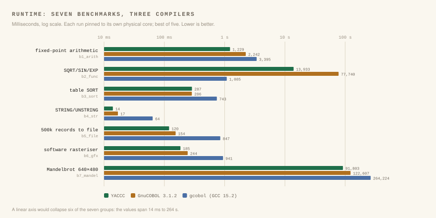
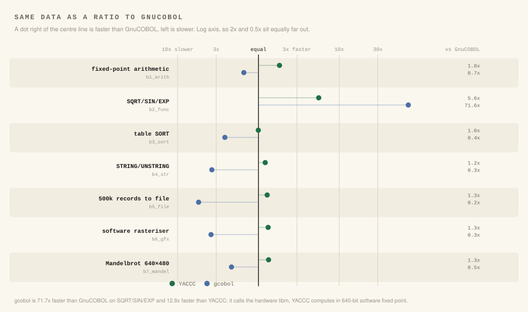

# Benchmarks

YACCC against five other COBOL compilers. One machine: 2× 22-core Xeon E5-2696
v4, 44 physical cores, SMT enabled. Same `-O2`, results verified identical
before timing. Numbers are wall-clock for the whole process, including startup.

| Compiler | Version | Where it came from |
|---|---|---|
| YACCC | this checkout | `./yaccc` |
| GnuCOBOL | 3.1.2 | built from source, `--without-db` |
| GnuCOBOL | 3.2 | Ubuntu 26.04 package |
| GnuCOBOL | 4.0-early-dev.0 | Ubuntu 26.04 package |
| gcobol | 15.2.0 (GCC 15.2) | Ubuntu 26.04 package |
| gcobol | 16.0.1 20260322 (GCC 16, experimental) | Ubuntu 26.04 package |

GnuCOBOL 3.1.2 was built `--without-db`, so it has no ISAM handler; none of
these programs use indexed files. gcobol 16 is a trunk snapshot published as
`16.0.1 20260322 (experimental)`, not a release — it is included because it is
the fastest compiler in the field on one benchmark, and dropping it would make
every other result look better than it is.

## Runtime

Milliseconds, best of 15 runs, each run pinned to its own physical core and
timed one at a time. Lower is better; bold is the fastest in the row.

| Benchmark | YACCC | GnuCOBOL 3.1.2 | GnuCOBOL 3.2 | GnuCOBOL 4.0 | gcobol 15.2 | gcobol 16 |
|---|---:|---:|---:|---:|---:|---:|
| `b1_arith` | **965** | 1,772 | 1,021 | 1,759 | 2,911 | 2,809 |
| `b2_func` | 12,849 | 69,473 | 68,677 | 69,063 | 837 | **787** |
| `b3_sort` | 226 | 221 | **195** | 216 | 612 | 1,365 |
| `b4_str` | **12** | 15 | 15 | 14 | 50 | 816 |
| `b5_file` | **93** | 119 | 163 | 555 | 654 | 980 |
| `b6_gfx` | **145** | 190 | 180 | 197 | 722 | 892 |
| `b7_mandel` | **79,936** | 111,210 | 89,289 | 109,646 | 264,904 | 269,127 |



What each program does:

| Benchmark | Work |
|---|---|
| `b1_arith` | 3,000,000 fixed-point `COMPUTE`/`ADD` |
| `b2_func` | 300,000 `SQRT`/`SIN`/`EXP` iterations on `COMP-2` |
| `b3_sort` | the `SORT` verb over a 200,000-entry table |
| `b4_str` | 200,000 `STRING` operations |
| `b5_file` | write and read back 500,000 records |
| `b6_gfx` | 200 frames of a software rasteriser: 24 rotated triangles, scanline-filled into 320×224 |
| `b7_mandel` | Mandelbrot, 640×480, up to 2,000 iterations, 28-bit fixed point |

**YACCC is fastest on five of the seven.** Against the best GnuCOBOL, 3.2, the
margin runs from 1.06× on arithmetic to 1.75× on sequential files:

- `b4_str` **1.25×**, `b6_gfx` **1.24×**, `b5_file` **1.75×**, `b7_mandel` **1.12×**
- `b2_func` **5.3×** faster than any GnuCOBOL, and **16.3× slower** than gcobol 16
- `b1_arith` **1.06×** — the narrowest win, and it repeats to three
  significant figures across runs, so it is small but not noise
- `b3_sort` **0.86×** — YACCC is **16% slower** than GnuCOBOL 3.2

Against gcobol 16 the picture is wider in both directions: YACCC is faster on
six of the seven, by 2.9× on arithmetic to 68× on strings, and 16.3× slower on
`b2_func`.



### Why the two losses happen

`b2_func` is a design difference, not a defect. gcobol lowers the intrinsics to
native `double` and the hardware libm; YACCC runs them through its own 640-bit
software fixed-point, which carries more significant digits and exact scaling
but costs an order of magnitude. All six compilers agree on the result to about
1e-11 relative.

`b3_sort` is the interesting one, because it is the only row where a GnuCOBOL
beats YACCC. YACCC's `cob_table_sort` builds an array of record pointers,
copies the whole 1.8 MB table, `qsort`s the pointers, and copies the table back
(`runtime/cobrt_io.c`). Two full copies and a pointer chase per comparison is
the likely cost at 200,000 records. GnuCOBOL 3.2 is 16% faster here and
GnuCOBOL 3.1.2 within 2.3%; both gcobols are 2.7× and 6× slower.

GnuCOBOL 4.0 is slower than 3.2 on six of the seven — 3.4× on `b5_file`, 1.7×
on `b1_arith`, 1.2× on the Mandelbrot, and within 11% on the rest; it wins only
`b4_str`, by 7%. It is labelled `4.0-early-dev` by its own maintainers and is
included for completeness, not as a representative of GnuCOBOL's shipped
performance.

### What the chart does and does not show

Each row is scaled to its own slowest compiler, so bar length is the ratio
within the row and the absolute milliseconds sit in the column at right. The
values span 12 ms to 269 s, about four and a half decades: on a shared log axis
a 3× difference is a few percent of the width and reads as "about the same",
and on a shared linear axis everything but the slowest benchmark collapses
against the left edge. Bar lengths are therefore **not** comparable between
rows. Compare within a row; read the column for magnitude.

## Compile time

Seconds, best of three, on the same machine.

| Source | Lines | YACCC | GnuCOBOL 3.1.2 | GnuCOBOL 3.2 | GnuCOBOL 4.0 | gcobol 15.2 | gcobol 16 |
|---|---:|---:|---:|---:|---:|---:|---:|
| `b1_arith` | 16 | 0.25 | 0.12 | 0.12 | **0.11** | 0.13 | 0.13 |
| `b4_str` | 24 | 0.22 | 0.12 | 0.12 | **0.11** | 0.12 | 0.12 |
| `b6_gfx` | 154 | 0.54 | 0.28 | 0.28 | **0.27** | 1.12 | 1.69 |
| `b7_mandel` | 59 | 0.31 | 0.16 | 0.15 | **0.14** | 0.32 | 0.34 |
| `big` | 4,207 | 4.43 | 2.10 | **2.07** | 2.10 | 9.54 | 12.39 |

YACCC is about **2× slower to compile than GnuCOBOL**, consistently at every
size. It is a Python program front to back with no build step; GnuCOBOL is
native. The gap is the interpreter, not the code generator, and it is the price
of the thing that makes YACCC easy to work on. Against gcobol the order
reverses: on the 4,207-line program YACCC is **2.2× faster to compile** than
gcobol 15 and **2.8× faster** than gcobol 16.

`big` is generated, not checked in — four thousand lines of near-identical
paragraphs would be 100 KB of noise in every clone. `tests/bench/gen_big.py`
writes it deterministically at exactly 4,207 lines including its copybook:

```
./tests/bench/gen_big.py /tmp/big
```

The compile-time figures are taken by hand, three times each, keeping the best:
`yaccc src -I /tmp/big -O2 -o out`, `cobc -x -O2 -I /tmp/big -o out src`, and
`gcobol src -I /tmp/big -O2 -o out`. All six produce
`+0090095603066.32` when the generated program runs, so the figure is only
meaningful for a source they all accept.

Two portability facts that cost time to find, and that anyone regenerating this
will hit: GnuCOBOL folds a `COPY` operand to upper case and then looks for a
file of exactly that name, so `bigcopy.cpy` is not found where `BIGCOPY.cpy`
is; and every paragraph must end its sentence with a full stop, or GnuCOBOL
reports the *next* paragraph header as an undefined name.

## Binary size

Bytes, `-O2`, one executable per program.

| | YACCC | GnuCOBOL 3.1.2 | GnuCOBOL 3.2 | GnuCOBOL 4.0 | gcobol 15.2 | gcobol 16 |
|---|---:|---:|---:|---:|---:|---:|
| `b1_arith` | 439,880 | **14,664** | **14,664** | 14,744 | 25,760 | 23,912 |
| `b4_str` | 439,960 | **14,728** | **14,728** | 14,808 | 26,392 | 24,432 |
| `b6_gfx` | 454,608 | **23,432** | **23,432** | 27,608 | 83,528 | 86,256 |
| `b7_mandel` | 449,656 | **19,368** | **19,368** | 19,448 | 45,704 | 44,704 |
| `big` (4,207 lines) | 739,200 | **113,096** | **113,096** | 113,176 | 637,680 | 522,288 |

YACCC links its runtime statically, so a hello-world is **30× larger** than
GnuCOBOL's and the gap narrows as the program grows (6.5× at 4,207 lines). The
others link a shared library at run time. A `-static` option for programs that
need to move between machines without the archive is not implemented; this is
the clearest thing on the list worth fixing.

## What this does not measure

- **No commercial compiler was tested.** IBM Enterprise COBOL, Micro Focus,
  Fujitsu and Veryant are not here. "Fastest of the six open-source compilers
  measured, on these seven programs" is the claim the data supports; "fastest
  COBOL compiler" is a claim about the world that this suite cannot reach.
- **Seven synthetic microbenchmarks, each 16–154 lines.** Real COBOL is batch
  I/O and indexed file access. `b5_file` measures plain sequential files
  because the GnuCOBOL oracle has no ISAM handler; ISAM and VSAM, where
  production COBOL spends its time, are untested.
- **One machine, shared.** Other users were logged in and the load average on
  44 cores sat between 1.3 and 4.0 during measurement. Runs were serialised to
  keep memory bandwidth free, and the close rows were re-measured three times
  at 15 repetitions agreeing to three significant figures, but these are
  indicative numbers, not a laboratory result.
- **Speed is not the only axis.** gcobol and GnuCOBOL accept dialects and
  features YACCC does not. A compiler that is 25% faster on the programs it
  accepts is not faster at all on a program it rejects.

## Reproducing

The programs and runners are in the repository under `tests/bench/`. The runner
times whatever compilers it finds, plus any named in `BENCH_COMPILERS`:

```
# the two on PATH
./tests/bench/run.py --reps 15 --jobs 1

# the six-compiler field, each behind a one-line wrapper script
BENCH_COMPILERS='gnucobol-3.1.2=/opt/gc31/cobc,gnucobol-3.2=/opt/gc32/cobc,\
gnucobol-4.0=/opt/gc40/cobc,gcobol-15.2=/opt/gc15/gcobol,gcobol-16=/opt/gc16/gcobol' \
    ./tests/bench/run.py --reps 15 --jobs 1 > /tmp/run.txt

# the figures, from that run's own output
./tests/bench/figures.py /tmp/run.txt
```

`--jobs 1` times one program at a time. Pinning each run to its own core stops
two runs sharing an SMT sibling, but it does not stop them sharing memory
bandwidth: at `--jobs 44` every number in this table rises by about a quarter
and the ordering of the close rows changes. Use `--jobs 1` for numbers you
intend to publish, and the default only for a quick look.

The command line for each compiler is chosen from its file name: a name
containing `gcobol` is driven like gcobol, one containing `cobc` like GnuCOBOL,
`yaccc` like this repository's compiler. Versions that are not installed
system-wide need only a wrapper that sets its own library path, which is how
the three GnuCOBOL releases were kept side by side.
