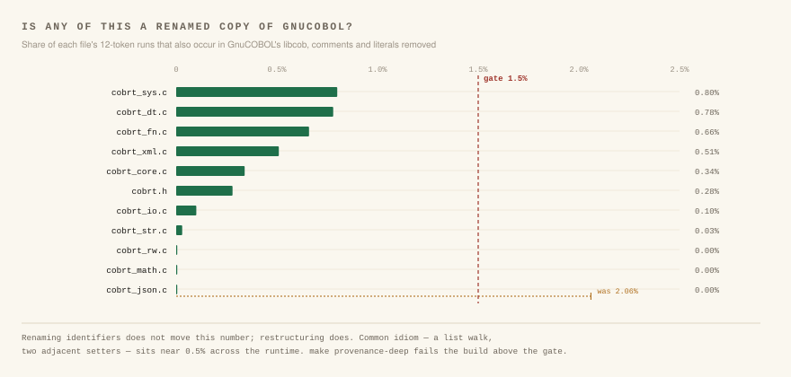

# Provenance

YACCC is MIT. GnuCOBOL is GPL-3.0. The two never share a tree, and this note
records how that is checked and what the measurements show — for anyone
auditing it, rather than as part of the pitch.

## What the rule is

- No GnuCOBOL source text, function body or comment is in this repository.
- The compiler, the C runtime and every test program were written for YACCC.
- Both reference suites (NIST CCVS85, GnuCOBOL's own testsuite) are fetched at
  test time into `third_party/`, which is `.gitignore`d and contains zero
  tracked files. Running them puts GPL-3.0 code on your disk; GnuCOBOL's
  licence governs *that copy*, not this code.

## How it is enforced

`make provenance` is the default gate. It fails the build on:

- any tracked file under `third_party/`;
- a GPL notice in a tracked source file;
- a missing `SPDX-License-Identifier: MIT` line;
- the presence of a distinctive GnuCOBOL function name (`do_page_footing`,
  `report_line_type`, `saveLineCounter` and five others);
- a `LICENSE` that is not MIT;
- a README with no acknowledgements.

A name grep cannot see a translation that renamed everything, so
`make provenance-deep` measures the code itself against a real GnuCOBOL
checkout (`third_party/gnucobol`, fetched by `make gctest`, or `GNUSRC`). It
scores every tracked source file two ways:

| Measure | Catches | Limit |
|---|---|---|
| verbatim 12-token runs | a file carried over with its names intact | 1.5%, and at least 40 matched runs |
| 20-token runs with every name and number replaced by a placeholder | the same file after a mechanical rename | 3% |

Two details make the numbers mean something:

- **Preprocessor lines are stripped from both sides.** Every C file opens with
  the same `#include` block; matching it says nothing about provenance, and
  counting it made small files look guilty — `cobrt_prof.c` measured 1.495%
  against a 1.5% limit, of which ten of eleven matched runs were includes,
  leaving 0.143%.
- **The verbatim check needs a minimum count as well as a percentage.** A
  fixed-size idiom prologue is a large fraction of a small file and nothing in
  a large one. Across this tree, ordinary idiom — a table of string literals
  with a loop over it, a `printf` format, a character scan — tops out at 18
  matched runs. A translation does not: the removed Report Writer port matched
  124.

The gate fails rather than skipping when the sources are absent. A check that
cannot run must not report success.

## What it measures on this tree

Highest files, at the time of writing:

| File | verbatim | shape |
|---|---|---|
| `runtime/cobrt_conf.c` | 1.38% | 1.44% |
| `runtime/cobrt_xmlp.c` | 0.54% | 2.51% |
| `runtime/cobrt_dt.c` | 0.84% | 0.96% |
| `runtime/cobrt_rw.c` | 0.00% | 0.75% |

## The Report Writer

This is the one file with a history worth writing down.

Its behaviour was learnt from GnuCOBOL 3.1.2: the report tables `cobc -C`
emits, the output of the runnable Report Writer tests, and a live `cobc` driven
over generated report shapes with probes printing `PAGE-COUNTER` and
`LINE-COUNTER` on every line. The model is written up in
[report-writer-page-model.md](report-writer-page-model.md).

An earlier attempt ported the reference's runtime instead. It was a
translation rather than an implementation — the same breakdown into functions,
the same branch order, identifiers changed — and it was removed rather than
kept. It scored 10.7% on the shape measure, against 0.75% for what replaced
it.

That attempt is not in this repository's history, which is a single squashed
commit rather than the development history. The figures above are recorded
here because a reader cannot re-derive them from the tree; what a reader *can*
check is the measure itself, which is `tests/provenance_test.py`, and the
current score, which anyone can reproduce by running it.

The engine in `runtime/cobrt_rw.c` is YACCC's own group-table design from
before that port, plus a line cursor whose rules were measured from `cobc`'s
output. It is **not** a clean-room implementation: whoever made the port had
read `reportio.c`, and the cursor rules were added by the same author. The
claim therefore rests on the code, which is measured — 0.00% verbatim, 0.75%
by shape, and 0.07% against `reportio.c` alone.

## What the measure cannot do

It is a regression net, not a proof. It catches a file translated whole. A
careful paraphrase can stay under both limits: the restructured version of the
removed port scores 1.10% verbatim and 8.77% by shape, so the shape measure
catches it, but a more patient rewrite might not.

What it does guarantee is that nobody can land another wholesale port, renamed
or not, the way the last one landed.

## If you redistribute a build

Nothing here obliges you to credit GnuCOBOL. YACCC is not a derivative work of
it and its licence does not reach this code. Crediting it is still the honest
thing to do, because without GnuCOBOL there would have been nothing to be
compatible *with*.
